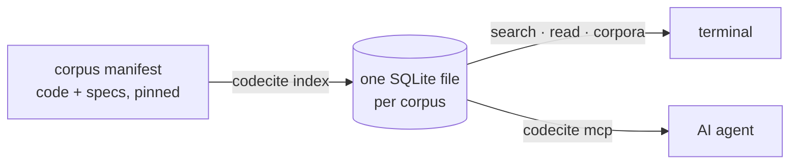

# codecite

A local index of code and specs that answers AI agents with cited results.

codecite is a single Rust binary. It indexes source repositories and reference
specs into one SQLite file per corpus, and answers through a CLI and an MCP
server. Every result cites where it came from — `repo@sha:path#L10-L42` — so an
agent builds on real implementations and spec text instead of recalling them
from memory.



## What it does

| Command | What you get |
| --- | --- |
| `codecite index <corpus>` | Indexes the local checkouts, git repositories (at pinned commits) and spec documents (pinned by sha256) that `corpora/<corpus>.toml` lists. Code splits at definitions with tree-sitter (Rust, Python, TypeScript, JavaScript, Go, C#); RFC and OpenID HTML splits into numbered sections and steps. Later runs work offline and rewrite only what changed |
| `codecite search <corpus> "<query>"` | Ranked results, each with its citation, license class and when it was indexed. Identifiers match however they are written (`validate token` finds `validateToken`) |
| `codecite grep <corpus> <pattern>` | Lines matching a regex, or exact text with `--fixed`, across the indexed code and specs, each with its citation: a code line, or the spec step or section that holds it. For the literal strings ranking is weak at: a claim name, an error message, `token_type_hint=\w+` |
| `codecite read <corpus> <citation>` | The exact text a citation points at, under its pinned citation. Accepts the canonical forms search prints and the ones people write: `RFC 9449 §4.3`, `OIDC Core §3.1.3.7 step 13`, a spec URL |
| `codecite def <corpus> <symbol>` | Every definition of a symbol, by its exact name (`callback`) or dotted (`Client.callback`), source first. Several matches are all listed and marked ambiguous, never one guess |
| `codecite requirements <corpus> <citation>` | Every rule governing a spec section, each cited: its MUST and SHOULD sentences, the REQUIRED and PROHIBITED rows of its claim and parameter lists, and its steps, with those of its subsections and of the sections it names or that name it, grouped by section, MUSTs first. Run it before implementing anything a spec governs |
| `codecite corpora` | The indexed corpora as JSON, with each one's age, size, source count and staleness |
| `codecite mcp` | An MCP server over stdio. Its tools `corpora`, `search`, `grep`, `definition`, `read` and `requirements` return the same JSON as the commands `corpora`, `search`, `grep`, `def`, `read` and `requirements` (with `--json` for all but `corpora`), byte for byte, and an error is a tool error with its kind and candidates |

A citation that doesn't resolve to exactly one span is an error listing the
candidates, never a guess, and an index older than its manifest's
`max_age_days` is refused unless you pass `--allow-stale`.

## Install

```sh
cargo install --git https://github.com/jamescrowley321/codecite codecite --locked
```

This builds the `codecite` binary from this repository with the pinned
dependency versions. codecite is not on crates.io yet (#110). It needs Rust
1.99.1 or newer and a C compiler, since the tree-sitter grammars and SQLite are
compiled from C. Git sources also need `git` on `PATH`.

## Quick start

Corpus manifests live in this repository, under `corpora/`. `codecite index
<corpus>` reads `corpora/<corpus>.toml` from the current directory, so run it
from a checkout, or pass `--manifest <file>`. The identity corpus indexes
identity-model from `~/repos/auth/identity-model`, so clone it there first.

```console
$ git clone https://github.com/jamescrowley321/codecite && cd codecite
$ codecite index identity
indexed corpus `identity` into ~/.local/share/codecite/identity.db
documents: 865 written, 0 unchanged, 0 removed
chunks: 12187 written
fetched: 0 downloaded, 39 from the cache
skipped: 39 ignored, 7 deny-listed, 4 symlink, 1 binary
elapsed: 6.16s
```

The first run downloads the 39 pinned specs (`fetched: 39 downloaded`); later
runs read them from the cache. `codecite search` ranks chunks by BM25 and
cites each one:

```console
$ codecite search identity "validate DPoP proof jti" --limit 2
2 results · adapt · indexed 2026-10-20T20:34:15Z
1. identity-model@9458d60f4f2f:rust/src/dpop/proof.rs#L207-L212 · function new_jti · 32.7
   fn new_jti() -> Result<String> {
2. identity-model@9458d60f4f2f:go/internal/conformance/dpop_test.go#L23-L87 · function runDPoPVector · 32.2
   func runDPoPVector(t *testing.T, label, base string, v HTTPVector) {
```

`codecite read` prints the text a citation points at, for the citations
search prints and the forms people write:

```console
$ codecite read identity "OIDC Core §3.1.3.7 step 13"
openid-connect-core-1_0@sha256:4d016752a645#section-3.1.3.7/step-13
step · ID Token Validation · SHOULD · quote · indexed 2026-10-20T20:34:20Z

13. If the auth_time Claim was requested, either through a specific request for this Claim or by using the max_age parameter, the Client SHOULD check the auth_time Claim value and request re-authentication if it determines too much time has elapsed since the last End-User authentication.
```

`codecite corpora` lists what is indexed, as the MCP `corpora` tool returns it:

```console
$ codecite corpora
{"corpora":[{"age_days":0.0,"corpus":"identity","indexed_at":"2026-10-20T22:56:30Z","max_age_days":30,"size_bytes":41594880,"sources":40,"stale":false}]}
```

To give an agent the same answers, register the MCP server, for example with
Claude Code:

```sh
claude mcp add codecite -- codecite mcp
```

## Documentation

- [Using codecite](docs/usage.md): manifests, indexing, search, citation
  forms, and connecting an agent.
- [Design](docs/design.md): goals, architecture and data model diagrams,
  ranking, licensing, security and the evaluation plan.
- [Milestones](https://github.com/jamescrowley321/codecite/milestones): the
  work, in order.

## Where it is going

- Optional local embeddings, merged with BM25 ranking.
- A code graph — definitions, references, callers, callees, impact — merged from
  tree-sitter, SCIP, LSP, CodeGraph and Graphify, with every edge tagged by the
  provider that produced it and how far to trust it.
- License detection (SPDX) checked against each manifest's license class, so
  agents know what they may adapt and what they may only learn from.
- Fully local: no server process, no telemetry, no network access beyond
  fetching pinned sources.

## Build

`rust-toolchain.toml` pins the compiler; rustup installs it on the first
`cargo` call. Build with `cargo build --workspace` and run with
`cargo run -p codecite -- --version`.

CI runs `cargo fmt --check`, `cargo clippy --workspace --all-targets --locked -- -D warnings`,
`cargo test --workspace --locked` and `cargo deny check` on every PR. Run them
locally before pushing; `--locked` fails if `Cargo.lock` is out of date, as it
does in CI. `cargo deny` needs `cargo install cargo-deny --locked`. PRs are also
gated on security scans (zizmor, gitleaks, OSV-Scanner, dependency review and
CodeQL); `SECURITY.md` says how to report a vulnerability.

## License

codecite is licensed under the [Apache License 2.0](LICENSE). Attribution notices are in [NOTICE](NOTICE).
