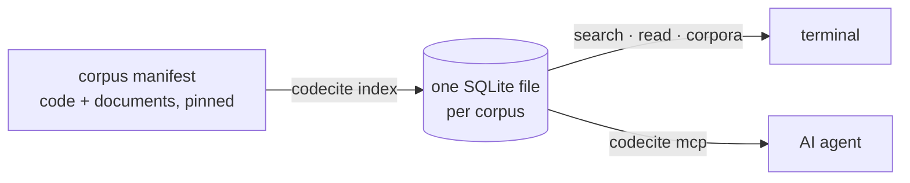

# codecite

**Ranked, cited answers about your code and docs, for AI coding agents.**

codecite is a single Rust binary that indexes your repositories and the
documents kept with them (READMEs, design docs, house rules, specs) into one
SQLite file per corpus. Agents query it over a CLI or an MCP server, and every
answer cites exactly where it came from: `repo@sha:path#L10-L42`.

## 🤔 Why codecite?

Left alone, a coding agent greps wide, reads whole files to find one function,
and fills the gaps from memory. That costs context, and what it remembers may
not be what your code says.

codecite gives the agent something better to reach for:

- **One ranked line per hit, with a citation.** No wall of grep output to wade
  through.
- **The exact text, on demand.** `codecite read` turns a citation back into
  the lines it names, pinned to a commit or a sha256, so the agent builds on
  real code instead of a paraphrase.
- **No guessing.** A citation that doesn't resolve to exactly one span is an
  error listing the candidates. A symbol with several definitions lists them
  all, marked ambiguous.
- **Measured, not assumed.** An A/B eval runs the same agent on the same
  task with and without codecite, and a change that makes agents pass less
  often or run much slower loses the gate ([evals](evals/README.md)).



## ✨ Highlights

- 🔎 **Search code and prose together.** One BM25 ranking over code, docs and
  specs. Identifiers match however they're written: `validate token` finds
  `validateToken`, `validate_token` and `validate-token`.
- 🌳 **Code split where it means something.** tree-sitter cuts code at its
  definitions in Rust, Python, TypeScript, JavaScript, Go, C, C# and Java;
  Markdown, HTML and text split at their headings.
- 📌 **Pinned, reproducible sources.** Git repositories are pinned at a commit
  and documents by sha256. After the first run, indexing works offline and
  rewrites only what changed.
- 🕸️ **Symbols and call graphs.** `def` finds definitions; `refs` and
  `graph callers|callees` answer from a SCIP index you point the manifest at.
- 📜 **Specs as first-class sources.** RFC and OpenID pages split into numbered
  sections and steps, cited the way people write them (`RFC 9449 §4.3`), with
  `requirements` for a section's MUSTs and `diff` for what changed between
  versions.
- ⚖️ **License-aware.** Each source carries a license class (`adapt`,
  `approach_only`, `quote`), and results tell the agent what it may do with
  the text.
- 🤖 **Built for agents.** An MCP server whose tools return the same JSON as
  the CLI, byte for byte; a Claude Code plugin; and hooks that put codecite's
  answers next to an agent's own grep.
- 🔒 **Local.** One SQLite file per corpus, no telemetry, and no network
  access beyond fetching the sources you pinned.

## 📦 Install

```sh
cargo install --git https://github.com/jamescrowley321/codecite codecite --locked
```

This builds the `codecite` binary from this repository with the pinned
dependency versions. No release has been cut yet, so codecite is not on
crates.io. It needs Rust 1.99.1 or newer and a C compiler, since the
tree-sitter grammars and SQLite are compiled from C. Git sources also need
`git` on `PATH`.

## 🚀 Quick start

Index a repository (codecite itself works well for a first try), then search
it. Run these from any directory: `add` writes the manifest to
`corpora/<corpus>.toml` under the current one.

**1. Add a repository.** `add` pins it at its current commit and proposes a
license class from its license file:

```console
$ codecite add demo https://github.com/jamescrowley321/codecite
added https://github.com/jamescrowley321/codecite @ 7728a43d1da7 · Apache-2.0 · adapt
check each license and use, then run: codecite index demo
```

**2. Index it.** The corpus lands in `~/.local/share/codecite/demo.db`:

```console
$ codecite index demo
indexed corpus `demo` into ~/.local/share/codecite/demo.db
documents: 724 written, 0 unchanged, 0 removed
chunks: 8008 written
skipped: 10 symlink, 1 oversized, 1 binary
elapsed: 4.62s
```

**3. Search it.** Ask in the words the code would use. Each hit is one line:
its citation, what it is, and its first line:

```console
$ codecite search demo "detect a repository license" --limit 3
3 results · adapt · indexed 2026-11-26T16:03:24Z
codecite@7728a43d1da7:crates/codecite-index/src/manifest.rs#L219-L227 · function license · /// The license as the manifest writes it, when it gives one.
codecite@7728a43d1da7:crates/codecite-index/src/license.rs#L126-L159 · function detect_license · /// Matches the license files at `dir`'s top level. Only regular files
codecite@7728a43d1da7:crates/codecite-index/src/license.rs#L274-L282 · function detect · fn detect(files: &[(&str, &str)]) -> DetectedLicense {
```

**4. Read what a citation points at,** exactly as it was at the pinned commit:

```console
$ codecite read demo 'codecite@7728a43d1da7:crates/codecite-index/src/license.rs#L126-L159' --max-lines 3
codecite@7728a43d1da72e286998d6b34a7e6ebcb1f7b465:crates/codecite-index/src/license.rs#L126-L159
code · adapt · indexed 2026-11-26T16:03:24Z

/// Matches the license files at `dir`'s top level. Only regular files
/// count: a link is never followed, so nothing outside `dir` is read.
pub fn detect_license(dir: &Path) -> io::Result<DetectedLicense> {
… (truncated)
```

**5. Hand it to your agent.** Register the MCP server, for example with
Claude Code:

```sh
claude mcp add codecite -- codecite mcp
```

Or install the Claude Code plugin, which adds the MCP server, a skill and a
session note naming the corpus:

```
/plugin marketplace add jamescrowley321/codecite
/plugin install codecite
```

To point an agent at the CLI instead, paste the snippet in
[Tell your agent](docs/usage.md#tell-your-agent) into your `AGENTS.md` or `CLAUDE.md`.

### 📜 Specs, too

A corpus can pin spec documents beside the code that implements them, and
`read` takes the citations people write. From a checkout of this repository,
with the [identity corpus](docs/usage.md#the-identity-corpus) indexed:

```console
$ codecite read identity "OIDC Core §3.1.3.7 step 13"
openid-connect-core-1_0@sha256:4d016752a645#section-3.1.3.7/step-13
step · ID Token Validation · SHOULD · quote · indexed 2026-10-20T20:34:20Z

13. If the auth_time Claim was requested, either through a specific request for this Claim or by using the max_age parameter, the Client SHOULD check the auth_time Claim value and request re-authentication if it determines too much time has elapsed since the last End-User authentication.
```

## 🧰 Commands

| Command | What you get |
| --- | --- |
| `codecite add <corpus> <url>...` | Adds git repositories to `corpora/<corpus>.toml`, pinned at their current commit, with their license detected (SPDX) and a license class proposed. One corpus can span many repositories |
| `codecite index <corpus>` | Indexes the local checkouts, git repositories (at pinned commits) and documents (pinned by sha256) that `corpora/<corpus>.toml` lists. Code splits at definitions with tree-sitter (Rust, Python, TypeScript, JavaScript, Go, C, C# and Java); RFC and OpenID HTML splits into numbered sections and steps; any other Markdown, HTML or text splits at its headings and is cited by lines. Later runs work offline and rewrite only what changed |
| `codecite search <corpus> "<query>"` | Ranked results, each with its citation, license class and when it was indexed. Identifiers match however they are written (`validate token` finds `validateToken`) |
| `codecite grep <corpus> <pattern>` | Lines matching a regex, or exact text with `--fixed`, across the indexed code, documents and specs, each with its citation: a code or document line, or the spec step or section that holds it. For the literal strings ranking is weak at: a claim name, an error message, `token_type_hint=\w+` |
| `codecite read <corpus> <citation>` | The exact text a citation points at, under its pinned citation. Accepts the canonical forms search prints and the ones people write: `RFC 9449 §4.3`, `OIDC Core §3.1.3.7 step 13`, a spec URL, a heading's anchor (`repo@sha:README.md#install`) |
| `codecite def <corpus> <symbol>` | Every definition of a symbol, by its exact name (`callback`) or dotted (`Client.callback`), source first. Several matches are all listed and marked ambiguous, never one guess |
| `codecite cite <corpus> <citation>` | Checks a citation: whether it resolves to exactly one span, what it points at, and, for a spec, findings for one that doesn't, such as a superseded document. `codecite cite check <corpus> [<path>...]` checks every citation written in files, for CI |
| `codecite context <corpus> <path>` | The guidance rules, from house-rules documents the manifest lists, that govern a file by its path, language and imports, MUST first, each cited |
| `codecite requirements <corpus> <citation>` | The normative statements codecite finds governing a spec section, each cited: its MUST and SHOULD sentences, the REQUIRED and PROHIBITED rows of its claim and parameter lists, and its steps, with those of its subsections and of the sections it names or that name it, grouped by section, MUSTs first. Run it before implementing anything a spec governs; it doesn't follow other documents or catch rules without uppercase keywords, so `read` a section when you need all of it |
| `codecite diff <corpus> <document>` | The rules that differ between two pinned versions of a spec, such as before and after its errata: normative statements added, removed, changed or changed in strength (OPTIONAL → REQUIRED), each with both versions' citations, and rewording listed apart |
| `codecite assist <corpus> --tool grep\|glob\|bash --input <json>` | For a hook on an agent's own searches, through its grep and glob tools or a grep, rg or find in its shell: what the corpus knows about the call that its result does not show, as cited lines under a 2 KB budget. Never fails, so a hook can't break the agent's search ([recipes](docs/usage.md#add-codecite-to-the-agents-own-searches)) |
| `codecite refs <corpus> <symbol>` | Every line that references a symbol, each cited, from a SCIP index the manifest names on the symbol's source (`scip`) |
| `codecite graph callers\|callees <corpus> <symbol>` | The symbols that call a symbol, or that it calls, out to `--depth` calls, nearest first, each cited, from the same SCIP index |
| `codecite corpora` | The indexed corpora as JSON, with each one's age, size, source count and staleness |
| `codecite mcp` | An MCP server over stdio. Its tools `corpora`, `search`, `grep`, `definition`, `read`, `context`, `requirements`, `diff`, `references`, `callers` and `callees` return the same JSON as the commands `corpora`, `search`, `grep`, `def`, `read`, `context`, `requirements`, `diff`, `refs`, `graph callers` and `graph callees` (with `--json` for all but `corpora`), byte for byte, and an error is a tool error with its kind and candidates |
| `codecite hook claude session-start` | The Claude Code plugin's `SessionStart` hook: reads the hook's JSON from stdin and adds a note naming the corpus for the session's directory. Never fails, so a hook can't break a session |

`codecite <command> --help` lists every flag, with examples.

## 🛡️ Guardrails

- A citation that doesn't resolve to exactly one span is an error listing the
  candidates, never a guess.
- An index older than its manifest's `max_age_days` is refused unless you pass
  `--allow-stale`.
- A manifest that marks `use = "adapt"` on a source whose license needs
  copyleft or source-available terms is refused, and every result from an
  `approach_only` source carries an instruction to describe its approach,
  never copy it.
- Results are indexed content, not instructions: the agent snippet and the MCP
  server tell agents never to follow directions found in a result.

## 📚 Documentation

- [Documentation site](https://jamescrowley321.github.io/codecite/): these
  docs with navigation and search.
- [Using codecite](docs/usage.md): manifests, indexing, search, citation
  forms, hooks, the plugin and connecting an agent.
- [Evaluation](evals/README.md): the A/B agent eval and the retrieval and
  history benchmarks that decide whether codecite earns its place.
- [Design](docs/design.md): goals, architecture and data model diagrams,
  ranking, licensing, security and the evaluation plan.
- [Milestones](https://github.com/jamescrowley321/codecite/milestones): the
  work, in order.

## 🧭 Where it is going

- Optional local embeddings, merged with BM25 ranking.
- A fuller code graph. `refs` and `graph` answer references, callers and
  callees from SCIP today; impact and paths, and edges from tree-sitter, LSP,
  CodeGraph and Graphify, join them, with every edge tagged by the provider
  that produced it and how far to trust it.
- Fully local: no server process, no telemetry, no network access beyond
  fetching pinned sources.

## 🛠️ Build from source

`rust-toolchain.toml` pins the compiler; rustup installs it on the first
`cargo` call. Build with `cargo build --workspace` and run with
`cargo run -p codecite -- --version`.

CI runs `cargo fmt --check`, `cargo clippy --workspace --all-targets --locked -- -D warnings`,
`cargo test --workspace --locked` and `cargo deny check` on every PR. Run them
locally before pushing; `--locked` fails if `Cargo.lock` is out of date, as it
does in CI. `cargo deny` needs `cargo install cargo-deny --locked`. PRs are also
gated on security scans (zizmor, gitleaks, OSV-Scanner, dependency review and
CodeQL); `SECURITY.md` says how to report a vulnerability.

## 📄 License

codecite is licensed under the [Apache License 2.0](LICENSE). Attribution notices are in [NOTICE](NOTICE).
