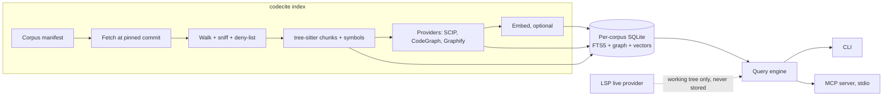

# codecite — design

The single living design for codecite: what it is, why, and how it is built. Edit it in place when the design changes; do not append addenda. Work and its status live in GitHub milestones and issues, never here. Where this document and the code disagree, the code wins and this document gets fixed in the same PR.

Ported on 2026-10-17 from the original Claude Doc design (written 2026-10-11), which this file supersedes.

## Summary

codecite is a single-binary Rust tool that indexes code and specs into one SQLite file per corpus and answers AI agents with cited results (`repo@sha:path#L10-L42`) through a CLI and an MCP server.

Its core idea is reference coding: before an agent writes something non-trivial, it looks up how proven implementations and the governing specs already handle it, and builds on that instead of guessing from memory.

**Goals**

- Agents retrieve real implementations and spec text, never paraphrased memory, with every result citing repo, commit, path and line range.
- A first-class code graph (definitions, references, callers, callees, impact, paths) merged from several providers: tree-sitter, SCIP, LSP, CodeGraph and Graphify.
- Every graph edge records which provider produced it and how much to trust it, so agents can demand exact edges for impact analysis.
- Fully local: no server process required, no telemetry, no network access beyond fetching pinned sources.
- Measurably fewer tokens and equal or better correctness than a grep-driven agent on real tasks.

**Non-goals**

- An Elasticsearch-compatible API, clustering or multi-tenant hosting.
- Indexing PHI, customer data or secrets.
- General-purpose document search or log analytics.
- Embedding in a hosted product in v1.

**First users:** Claude Code working on the identity-model ports (TypeScript, Go, Rust), and the startup's engineers working against internal repos and FHIR and HIPAA references.

## Background and prior art

codecite takes XERJ's best ideas without its weight or its unknowns, and treats existing graph tools as data sources rather than competitors.

| Project | What it is | Relationship to codecite |
| --- | --- | --- |
| [XERJ](https://github.com/xerj-org/xerj) | Rust search engine with an Elasticsearch-compatible API, corpus hub and MCP server; anonymous operator, pre-GA | Design reference only. Borrow ideas, write our own code |
| [CodeGraph](https://github.com/colbymchenry/codegraph) | Local SQLite symbol and call graph with an MCP server and Claude Code hooks | Provider: import its graph |
| [Graphify](https://github.com/Graphify-Labs/Graphify) | Knowledge graph over code, docs and images with confidence-tagged edges | Provider: import `graph.json`, keep its confidence tags |

**Borrowed from XERJ:** reference coding as a workflow, pinned corpus manifests with license classes, citations on every result, refusing stale indexes, content sniffing instead of trusting file extensions, and a with/without benchmark that reports losses.

**Skipped:** the Elasticsearch API, clustering, a custom storage engine, the web console, share tunnels and anything resembling its enterprise feature list.

XERJ is Apache-2.0, so reading it is unrestricted. Anything that carries over substantially keeps its attribution in NOTICE.

## Architecture

One Rust binary runs an index pipeline into a per-corpus SQLite file and answers both the CLI and MCP from it; LSP is the only live path that bypasses the store.



The workspace has five crates: `codecite-core` (schema and query engine), `codecite-index` (pipeline and providers), `codecite-lsp`, `codecite-mcp`, and the `codecite` binary that ties them together.

## Data model

Each corpus is one SQLite file in WAL mode, holding sources, chunks, a full-text index, optional vectors and a provider-tagged symbol graph.

```sql
CREATE TABLE meta     (key TEXT PRIMARY KEY, value TEXT);          -- schema_version, indexed_at, manifest_hash

CREATE TABLE source (
  id INTEGER PRIMARY KEY, repo_url TEXT NOT NULL, commit_sha TEXT NOT NULL,
  license_spdx TEXT, license_class TEXT NOT NULL,                   -- adapt | approach_only | excluded
  indexed_at TEXT NOT NULL
);

CREATE TABLE document (
  id INTEGER PRIMARY KEY, source_id INTEGER NOT NULL REFERENCES source(id),
  path TEXT NOT NULL, language TEXT, content_hash BLOB NOT NULL, size_bytes INTEGER,
  UNIQUE (source_id, path)
);

CREATE TABLE chunk (
  id INTEGER PRIMARY KEY, document_id INTEGER NOT NULL REFERENCES document(id),
  start_line INTEGER NOT NULL, end_line INTEGER NOT NULL,
  kind TEXT NOT NULL,                                               -- function | class | section | window
  symbol_id TEXT REFERENCES symbol(id),
  text TEXT NOT NULL,
  terms TEXT NOT NULL                                               -- identifiers split for search
);

CREATE VIRTUAL TABLE chunk_fts USING fts5(
  symbol, path, terms, content='', tokenize='unicode61'
);

-- optional, created only when embeddings are enabled
CREATE VIRTUAL TABLE chunk_vec USING vec0(chunk_id INTEGER PRIMARY KEY, embedding float[384]);

CREATE TABLE symbol (
  id TEXT PRIMARY KEY,                                              -- SCIP symbol string
  display_name TEXT NOT NULL, kind TEXT,
  document_id INTEGER REFERENCES document(id), start_line INTEGER, end_line INTEGER
);

CREATE TABLE edge (
  src TEXT NOT NULL, dst TEXT NOT NULL,
  kind TEXT NOT NULL,                                               -- defines | references | calls | imports | inherits | documents
  provider TEXT NOT NULL,                                           -- treesitter | scip | lsp | codegraph | graphify
  confidence INTEGER NOT NULL,                                      -- 3 exact, 2 extracted, 1 inferred, 0 ambiguous
  evidence_doc INTEGER REFERENCES document(id), evidence_line INTEGER,
  PRIMARY KEY (src, dst, kind, provider)
);
CREATE INDEX edge_dst ON edge(dst, kind);
CREATE INDEX symbol_name ON symbol(display_name);
```

- **Symbol IDs** are SCIP symbol strings, so precise indexers drop in without remapping. Symbols found only by tree-sitter get SCIP-shaped local IDs, replaced when a SCIP index for the same source arrives.
- **Edges from different providers are kept as separate rows.** Queries collapse them to the highest confidence and list every provider that agrees.
- **One file per corpus** keeps corpora portable and independently rebuildable. Cross-corpus queries use `ATTACH`.
- **Migrations** are numbered SQL files keyed off `meta.schema_version`; an index from a newer schema is refused, not guessed at.

## Provider model

Every source of code knowledge is a provider that writes chunks, symbols and edges into the same schema, so adding a tool never changes the query layer.

```rust
pub trait Provider: Send + Sync {
    fn id(&self) -> &'static str;
    fn capabilities(&self) -> Capabilities;            // chunks, symbols, edges, live
    fn index(&self, src: &SourceTree, sink: &mut dyn IndexSink) -> Result<IndexStats>;
}

/// Providers that answer against a live working tree (LSP).
#[async_trait::async_trait]
pub trait LiveProvider: Provider {
    async fn query(&self, q: &GraphQuery) -> Result<Vec<Edge>>;
}
```

| Provider | Mode | Produces | Confidence | Runs when |
| --- | --- | --- | --- | --- |
| tree-sitter | Index, built in | Chunks, symbols, approximate calls and imports | Extracted for definitions, inferred for calls | Always |
| SCIP | Index, reads `.scip` from scip-python, scip-typescript, rust-analyzer, scip-go, scip-dotnet | Precise definitions, references, symbol IDs | Exact | Indexer installed and source trusted |
| LSP | Live query | Definition, references, call hierarchy for the working tree | Exact | Your own workspace, with the server running |
| CodeGraph | Import, attaches its SQLite and maps a pinned schema version | Symbols and calls | Extracted | Its database exists for the repo |
| Graphify | Import `graph.json` | Doc-to-code concept links, plus code edges | Keeps its EXTRACTED, INFERRED, AMBIGUOUS tags | Its output exists for the repo |

- **Confidence ladder:** exact (3) beats extracted (2) beats inferred (1) beats ambiguous (0). Graph tools take a `min_confidence` argument; impact analysis defaults to 2.
- **Integration through outputs, not linking.** CodeGraph and Graphify are read from the files they write, which keeps codecite free of their dependencies and licenses.
- **Graphify concept nodes** get a `graphify:` namespace, because they are ideas rather than code symbols.
- **LSP results are never written to the index.** They answer live queries about uncommitted code and fall back to the index when no server is running.

## Indexing and retrieval

BM25 over code-aware terms does most of the work; vectors and graph signals refine it rather than replace it.

**Indexing pipeline**

1. **Fetch:** `git clone --filter=blob:none` at the manifest's pinned commit, or read a local working tree.
2. **Walk:** respect `.gitignore`, skip binaries by content sniffing, cap file size, apply the secrets deny-list.
3. **Chunk:** tree-sitter splits at function and class boundaries with line ranges. Prose and unsupported languages fall back to heading sections or 60-line windows.
4. **Terms:** split camelCase, snake_case and kebab-case identifiers and keep the original, so `validateToken` matches "validate token" and the exact name.
5. **Write:** chunks, full-text rows and symbols for one document in a single transaction.
6. **Providers:** SCIP, CodeGraph and Graphify run after the base pass and add symbols and edges.
7. **Embed (optional):** a small local model through `fastembed`, 384 dimensions, CPU only.

**Ranking**

- FTS5 `bm25()` with column weights: symbol name highest, then path, then body.
- With embeddings on, nearest neighbors from `chunk_vec`, merged with BM25 by reciprocal rank fusion (k = 60).
- An exact symbol-name match is boosted to the top.
- Filters by corpus, repo, language and path glob are plain SQL `WHERE` clauses.

**Freshness**

- Each document stores a content hash. Re-indexing a git source diffs the old commit against the new one and rewrites only changed documents.
- Each corpus has a maximum age (default 30 days). Older indexes are refused unless the caller passes `--allow-stale`, and every result carries its `indexed_at`.

**Initial targets, to validate in milestone 4:** index 100k lines of code in under 60 seconds without SCIP on a laptop, and answer BM25 queries over 1 million chunks in under 100 ms at p95.

## Corpus manifests and licensing

A committed TOML manifest is the source of truth for every corpus: what to index, at which commit, and how agents may use it.

```toml
name = "oidc-impls"
max_age_days = 30

[[source]]
url = "https://github.com/panva/openid-client"
commit = "<40-character SHA>"
license = "MIT"
use = "adapt"                    # adapt | approach_only | excluded
include = ["lib/**", "docs/**"]

[[source]]
url = "https://github.com/ramosbugs/openidconnect-rs"
commit = "<40-character SHA>"
license = "MIT OR Apache-2.0"
use = "adapt"
```

| Class | Typical licenses | What agents are told |
| --- | --- | --- |
| `adapt` | MIT, Apache-2.0, BSD, ISC | May adapt code; keep attribution and the license notice |
| `approach_only` | GPL, AGPL, LGPL, unknown, source-available | Describe the approach in your own words; never copy code |
| `excluded` | Anything the owner forbids or that holds secrets | Not indexed |

- **Detection plus confirmation:** codecite identifies the license file with SPDX matching (the `askalono` crate), but the manifest's `license` and `use` fields are written by a person. A mismatch is a warning on every index run.
- **Every result carries its license class.** MCP responses for `approach_only` sources include an explicit instruction not to copy.
- **No redistribution:** a shared manifest lists URLs and commits only; each user fetches the sources themselves.

## Interfaces

The CLI and the MCP server expose the same operations and return the same JSON, so anything an agent sees can be reproduced from a terminal.

| CLI command | Purpose |
| --- | --- |
| `codecite add <corpus> <url>...` | Add sources to a manifest, detect licenses, pin the current commit |
| `codecite index <corpus>` | Fetch, index and run providers; incremental by default |
| `codecite search <corpus> "<query>"` | Ranked chunks with citations |
| `codecite def <symbol>` | Where a symbol is defined |
| `codecite refs <symbol>` | Every reference to a symbol |
| `codecite graph <callers\|callees\|impact\|path> ...` | Graph queries with `--min-confidence` |
| `codecite read <citation>` | Print a cited span, capped in lines |
| `codecite corpora` | List corpora with age, size and staleness |
| `codecite mcp` | Run the stdio MCP server |

| MCP tool | Inputs | Returns |
| --- | --- | --- |
| `search` | `query`, `corpus?`, `language?`, `path?`, `limit` (default 10) | Ranked results |
| `definition` | `symbol`, `corpus?` | Definition sites |
| `references` | `symbol`, `min_confidence` | Reference sites |
| `callers` / `callees` | `symbol`, `depth` (default 1), `min_confidence` | Edges with providers |
| `impact` | `symbol`, `depth` (default 3), `min_confidence` (default 2) | Affected symbols, grouped by distance |
| `path` | `from`, `to`, `max_depth` | Shortest connecting chain |
| `read` | `citation`, `max_lines` (default 80) | Exact source text |
| `corpora` | none | Available corpora and freshness |

Every result has the same shape:

```json
{
  "citation": "github.com/panva/openid-client@3f2a9c1:lib/client.js#L412-L455",
  "symbol": "Client.callback",
  "score": 12.7,
  "license_class": "adapt",
  "providers": ["scip", "treesitter"],
  "confidence": 3,
  "indexed_at": "2026-10-11T14:02:00Z",
  "snippet": "..."
}
```

- Snippets are capped at 40 lines; agents call `read` for more, which keeps token use predictable.
- Errors are explicit: an unknown corpus, a stale index or an ambiguous symbol name returns a typed error with candidates, never an empty success.

## Security and privacy

codecite has no network listener by default and makes no outbound calls except fetching pinned sources, which keeps its attack surface close to that of a grep binary.

- **Network:** no telemetry. Outbound traffic is limited to `git` fetches listed in a manifest and a one-time embedding model download verified against a pinned hash.
- **Transport:** MCP over stdio by default. A remote MCP endpoint comes later behind the OIDC gateway, following the MCP authorization spec (OAuth 2.1, protected-resource metadata per RFC 9728).
- **Data boundary:** never index PHI, customer data or secrets. A deny-list skips `.env`, key and certificate files, and a secrets scan skips files with high-entropy credentials.
- **Untrusted code:** language servers and some SCIP indexers execute project code (rust-analyzer runs build scripts and proc macros, for example). They run only on sources marked trusted, with timeouts. Third-party reference corpora default to tree-sitter only.
- **Read-only queries:** `search`, `read` and the graph tools open the database read-only. Only `index` writes.
- **Supply chain:** pinned toolchain, `cargo-deny` in CI (its advisories check reads RustSec, the database `cargo-audit` uses), a minimal dependency set, and signed release artifacts with an SBOM.

## Evaluation plan

codecite earns its place only if agents using it finish real tasks correctly with at least 30% fewer tokens than agents using grep; the harness exists before most features do.

**Agent benchmark**

- **Tasks:** 20 real tasks from the identity-model ports (TypeScript, Go, Rust) and 10 from the startup (FHIR resources, audit logging). Each has a checkable outcome: tests or shared conformance vectors pass.
- **Arms:** the same model and prompt, once with only grep and file reads, once with codecite's MCP tools. Three runs per task per arm.
- **Measures:** pass rate, input and output tokens, tool calls, wall time, and citation accuracy (a sampled review of whether each cited span supports what the agent claimed).

**Retrieval benchmark**

- 100 labelled queries over the identity corpora, each with its known correct span.
- Recall@10 and MRR for BM25 alone, BM25 plus vectors, and BM25 plus graph boosts.

**Initial success criteria**

- At least 30% fewer total tokens with no drop in pass rate on port tasks.
- Recall@10 of at least 0.8 with BM25 alone.
- Losses are reported alongside wins, with the tasks where retrieval hurt.

## Milestones

Ten milestones in order, each shippable on its own; the first four make codecite useful, the rest make it precise. Each is a GitHub milestone, named with its number (`M1 Skeleton and CI`), and its issues are the work.

1. **Skeleton and CI:** Cargo workspace, `fmt`, `clippy -D warnings`, tests, `cargo-deny`, pinned toolchain.
   - Learn: workspace layout, lint discipline, error enums with `thiserror`.
2. **Index and search:** tree-sitter chunking for Rust, Python, TypeScript, Go and C#; FTS5 with split identifiers; `index`, `search`, `read`. Publish `codecite` 0.0.1.
   - Learn: `rusqlite`, transactions, tree-sitter queries.
3. **MCP server:** `search`, `read`, `definition` and `corpora` over stdio; wired into Claude Code.
   - Learn: `rmcp`, async `tokio`, JSON schemas.
4. **Evaluation harness v1:** both benchmarks and the first published numbers. Validates the performance targets.
   - Learn: benchmarking with `criterion`, honest measurement.
5. **Manifests and licensing:** `add`, pinned fetches, SPDX detection, license classes on results.
6. **SCIP provider and graph tools:** precise symbols, `references`, `callers`, `callees`, `impact`, `path`.
   - Learn: protobuf decoding, graph traversal in SQL with recursive CTEs.
7. **LSP live provider:** definition, references and call hierarchy against the working tree.
   - Learn: JSON-RPC over stdio, process lifecycles, timeouts and cancellation.
8. **CodeGraph and Graphify adapters:** imports with pinned schema versions and kept confidence tags.
9. **Embeddings and hybrid ranking:** `fastembed`, sqlite-vec, reciprocal rank fusion; rerun the benchmarks.
10. **Remote MCP with OIDC:** HTTP transport behind the Rust identity-model core and gateway.

## Decisions and open questions

Eight decisions are made for v1; seven questions remain open. Each open question becomes a GitHub issue once its milestone starts; when one is settled, move the answer into the decisions table and delete the question.

| Decision | Choice | Why | Revisit if |
| --- | --- | --- | --- |
| Language | Rust | Single static binary, fits the identity-model Rust port, learning goal | Never for the core |
| Storage | SQLite with FTS5 | Embedded, portable, debuggable with any SQLite client | Ranking or indexing speed falls short at 1M+ chunks; then tantivy |
| Vectors | sqlite-vec, off by default | BM25 carries code search; vectors are an add-on | Benchmarks show hybrid wins by a wide margin |
| Symbol IDs | SCIP symbol strings | An open standard shared by precise indexers | SCIP stops being maintained |
| Integrations | Read provider outputs, never link their code | No dependency or license entanglement | A provider offers a stable library API |
| Corpus layout | One SQLite file per corpus | Portable, independently rebuildable | Cross-corpus queries become the common case |
| MCP transport | stdio first | No network surface | Remote agents need it (milestone 10) |
| License | Apache-2.0 | Matches py-identity-model and the wider ecosystem | Never |

**Open questions**

- Split identifiers in a stored `terms` column, or write a custom FTS5 tokenizer? The column is simpler; the tokenizer is smaller on disk.
- Contentless FTS5 needs `contentless_delete=1` (SQLite 3.43 or later) for incremental updates. Confirm the bundled SQLite version supports it.
- Which embedding model gives the best recall on code at 384 dimensions?
- How to reconcile tree-sitter local symbols with SCIP IDs when both exist for the same definition.
- Graphify sends docs and images to Claude for extraction. Allow its doc pass only for public corpora?
- Confirm CodeGraph's and Graphify's licenses and how stable their output formats are.
- Windows support in v1, or macOS and Linux only?
