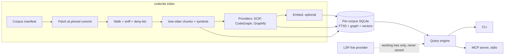
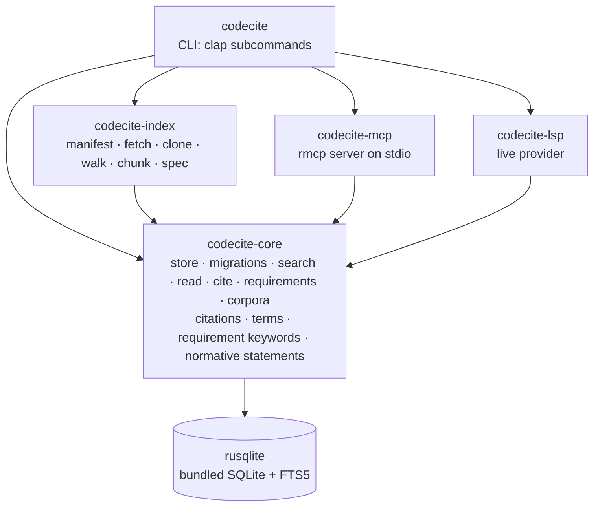
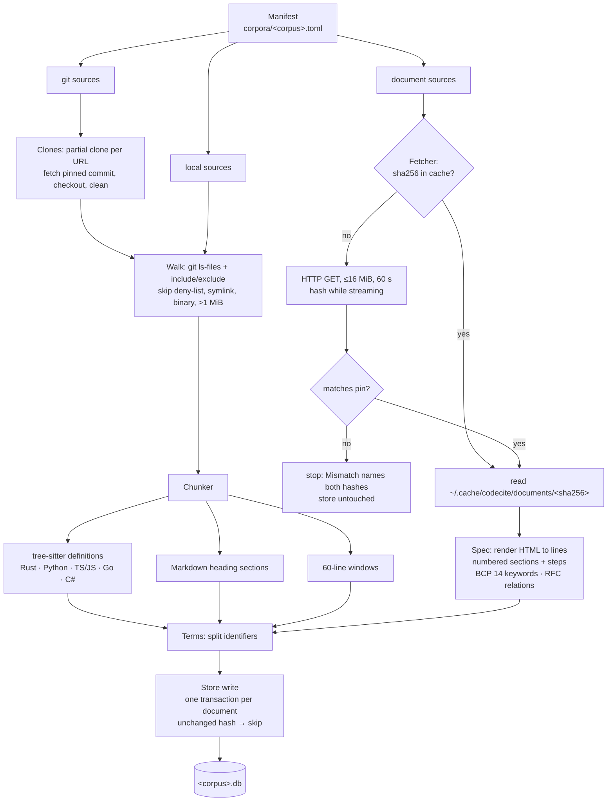
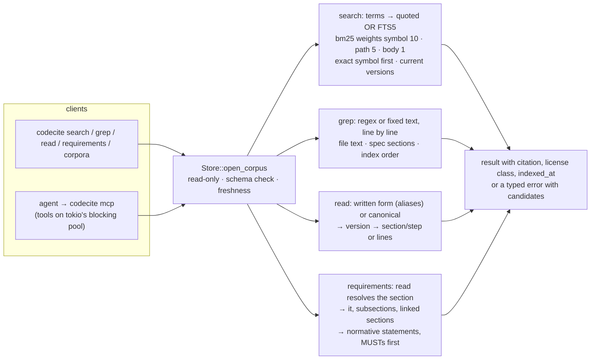
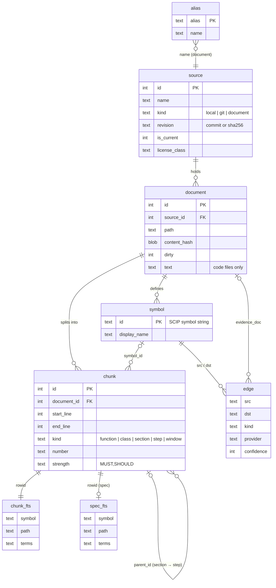

# codecite — design

The single living design for codecite: what it is, why, and how it is built. Edit it in place when the design changes; do not append addenda. Work and its status live in GitHub milestones and issues, never here. Where this document and the code disagree, the code wins and this document gets fixed in the same PR.

Ported on 2026-10-17 from the original Claude Doc design (written 2026-10-11), which this file supersedes.

## Summary

codecite is a single-binary Rust tool that indexes code and specs into one SQLite file per corpus and answers AI agents with cited results (`repo@sha:path#L10-L42`) through a CLI and an MCP server.

Its core idea is reference coding: before an agent writes something non-trivial, it looks up how proven implementations and the governing specs already handle it, and builds on that instead of guessing from memory.

**Goals**

- Agents retrieve real implementations and spec text, never paraphrased memory, with every result citing repo, commit, path and line range.
- A first-class code graph (definitions, references, callers, callees, impact, paths) merged from several providers: tree-sitter, SCIP, LSP, CodeGraph and Graphify.
- Every graph edge records which provider produced it and how much to trust it, so agents can demand exact edges for impact analysis.
- Fully local: no server process required, no telemetry, no network access beyond fetching pinned sources.
- No worse than a grep-driven agent on correctness, tokens or time on real tasks.

**Non-goals**

- An Elasticsearch-compatible API, clustering or multi-tenant hosting.
- Indexing PHI, customer data or secrets.
- General-purpose document search or log analytics.
- Embedding in a hosted product in v1.

**First users:** Claude Code working on the identity-model ports (TypeScript, Go, Rust), and the startup's engineers working against internal repos and FHIR and HIPAA references.

## Background and prior art

codecite takes XERJ's best ideas without its weight or its unknowns, and treats existing graph tools as data sources rather than competitors.

| Project | What it is | Relationship to codecite |
| --- | --- | --- |
| [XERJ](https://github.com/xerj-org/xerj) | Rust search engine with an Elasticsearch-compatible API, corpus hub and MCP server; anonymous operator, pre-GA | Design reference only. Borrow ideas, write our own code |
| [CodeGraph](https://github.com/colbymchenry/codegraph) | Local SQLite symbol and call graph with an MCP server and Claude Code hooks | Provider: import its graph |
| [Graphify](https://github.com/Graphify-Labs/Graphify) | Knowledge graph over code, docs and images with confidence-tagged edges | Provider: import `graph.json`, keep its confidence tags |

**Borrowed from XERJ:** reference coding as a workflow, pinned corpus manifests with license classes, citations on every result, refusing stale indexes, content sniffing instead of trusting file extensions, and a with/without benchmark that reports losses.

**Skipped:** the Elasticsearch API, clustering, a custom storage engine, the web console, share tunnels and anything resembling its enterprise feature list.

XERJ is Apache-2.0, so reading it is unrestricted. Anything that carries over substantially keeps its attribution in NOTICE.

## Architecture

One Rust binary runs an index pipeline into a per-corpus SQLite file and answers both the CLI and MCP from it; LSP is the only live path that bypasses the store.



The workspace has five crates: `codecite-core` (schema and query engine), `codecite-index` (pipeline and providers), `codecite-lsp`, `codecite-mcp`, and the `codecite` binary that ties them together.

The crates depend on core and never on each other; only the binary sees them all.



An index run reads the manifest, fetches every pinned input before it writes anything, then chunks and writes one document per transaction.



Queries open the corpus read-only, refuse a stale or newer-schema file, and return results that the CLI prints and the MCP tools return as the same JSON.



`codecite-mcp` serves MCP over stdio with `rmcp` on a single-threaded `tokio` runtime. Its tools are `rmcp` `#[tool]` methods: an input schema is generated from the tool's parameter type and an output schema from its result type (`schemars`), and the result types are the ones `codecite-core` returns to the CLI, so both print the same JSON. A tool runs its SQLite work on `tokio`'s blocking pool. stdout carries only MCP messages; anything else goes to stderr. A failed operation is a tool result with `isError` and the error's message and causes, so the agent can read it; an unknown tool or malformed request is a JSON-RPC error.

All five are laid out to publish to crates.io at one shared version, `workspace.package.version`; none is published yet, and publishing is #110. The internal crates require each other's exact version, since Cargo reads a `0.0.x` requirement as `=0.0.x`, so a release bumps all five together. `cargo publish --workspace` packages, verifies and uploads them in dependency order (`codecite-core`, then `codecite-index`, `codecite-lsp` and `codecite-mcp`, then `codecite`). Each package carries the root `README.md`, `LICENSE` and `NOTICE`; the crates link the last two as symlinks, which Cargo packages as files. Corpus manifests are not packaged: `codecite index <corpus>` reads `corpora/<corpus>.toml` from the current directory, or the file `--manifest` names.

## Data model

Each corpus is one SQLite file in WAL mode, holding sources, chunks, a full-text index, optional vectors and a provider-tagged symbol graph.

```sql
CREATE TABLE meta     (key TEXT PRIMARY KEY, value TEXT);          -- schema_version, indexed_at, max_age_days, manifest_hash

CREATE TABLE source (
  id INTEGER PRIMARY KEY, name TEXT NOT NULL,                       -- a document's versions share its name
  kind TEXT NOT NULL,                                               -- local | git | document
  url TEXT NOT NULL,                                                -- repo URL, local path or document URL
  revision TEXT NOT NULL,                                           -- commit SHA, or sha256 of a document
  is_current INTEGER NOT NULL DEFAULT 1,                            -- 0 for an older pinned version of a document
  obsoleted_by TEXT, updated_by TEXT,                               -- hand-written in the manifest
  license_spdx TEXT, license_class TEXT NOT NULL,                   -- adapt | approach_only | quote | excluded
  indexed_at TEXT NOT NULL
);
CREATE UNIQUE INDEX source_name ON source(name) WHERE kind <> 'document';
CREATE UNIQUE INDEX source_version ON source(name, revision) WHERE kind = 'document';

CREATE TABLE document (
  id INTEGER PRIMARY KEY, source_id INTEGER NOT NULL REFERENCES source(id) ON DELETE CASCADE,
  path TEXT NOT NULL, language TEXT, content_hash BLOB NOT NULL, size_bytes INTEGER,  -- content_hash: sha256 of the bytes
  dirty INTEGER NOT NULL DEFAULT 0,                                 -- a local file that differed from HEAD
  text TEXT,                                                        -- a code file's text, which read cites lines of; NULL for a spec
  UNIQUE (source_id, path)
);

CREATE TABLE alias (alias TEXT PRIMARY KEY, name TEXT NOT NULL);    -- "oidc core" -> openid-connect-core-1_0, from the manifest

CREATE TABLE chunk (
  id INTEGER PRIMARY KEY, document_id INTEGER NOT NULL REFERENCES document(id) ON DELETE CASCADE,
  start_line INTEGER NOT NULL, end_line INTEGER NOT NULL,
  kind TEXT NOT NULL,                                               -- function | class | variable | type_alias | section | step | window
  symbol_id TEXT REFERENCES symbol(id) ON DELETE SET NULL,
  number TEXT, anchor TEXT, title TEXT,                             -- a section's "3.1.3.7", "IDTokenValidation"; a step's "13"
  parent_id INTEGER REFERENCES chunk(id) ON DELETE CASCADE,         -- enclosing section of a section or step
  strength TEXT,                                                    -- requirement keywords found, e.g. "MUST,SHOULD"
  text TEXT NOT NULL,
  terms TEXT NOT NULL                                               -- identifiers split for search
);

CREATE VIRTUAL TABLE chunk_fts USING fts5(                          -- every chunk
  symbol, path, terms, content='', contentless_delete=1, tokenize='unicode61'
);
CREATE VIRTUAL TABLE spec_fts USING fts5(                           -- spec chunks again, stemmed
  symbol, path, terms, content='', contentless_delete=1, tokenize='porter unicode61'
);

-- optional, created only when embeddings are enabled
CREATE VIRTUAL TABLE chunk_vec USING vec0(chunk_id INTEGER PRIMARY KEY, embedding float[384]);

CREATE TABLE symbol (
  id TEXT PRIMARY KEY,                                              -- SCIP symbol string
  display_name TEXT NOT NULL, kind TEXT,
  document_id INTEGER REFERENCES document(id) ON DELETE CASCADE, start_line INTEGER, end_line INTEGER
);

CREATE TABLE edge (
  src TEXT NOT NULL, dst TEXT NOT NULL,
  kind TEXT NOT NULL,                                               -- defines | references | calls | imports | inherits | documents
  provider TEXT NOT NULL,                                           -- treesitter | scip | lsp | codegraph | graphify
  confidence INTEGER NOT NULL,                                      -- 3 exact, 2 extracted, 1 inferred, 0 ambiguous
  evidence_doc INTEGER REFERENCES document(id) ON DELETE CASCADE, evidence_line INTEGER,
  PRIMARY KEY (src, dst, kind, provider)
);
CREATE INDEX edge_dst ON edge(dst, kind);
CREATE INDEX symbol_name ON symbol(display_name);
CREATE INDEX chunk_document ON chunk(document_id);                  -- every foreign key is indexed, so a cascade never scans
CREATE INDEX chunk_parent ON chunk(parent_id);
CREATE INDEX chunk_symbol ON chunk(symbol_id);
CREATE INDEX symbol_document ON symbol(document_id);
CREATE INDEX edge_evidence ON edge(evidence_doc);
CREATE TRIGGER chunk_fts_delete AFTER DELETE ON chunk BEGIN
  DELETE FROM chunk_fts WHERE rowid = old.id;                       -- a contentless FTS table can't be a foreign key's child
END;
CREATE TRIGGER spec_fts_delete AFTER DELETE ON chunk BEGIN
  DELETE FROM spec_fts WHERE rowid = old.id;
END;
```

How the tables relate, with the columns that carry each relation:



- **Document versions** are separate sources: each pinned version of a document is its own `source` row, with the document's name, its `sha256` as `revision`, and `is_current`, `obsoleted_by` and `updated_by` from the manifest. A version is unique by name and revision, any other source by name. Results name a version as citations do, `rfc9449@sha256:1a2b3c4d5e6f`.
- **A query needs no manifest.** An index run stores what queries need from the manifest in the corpus: `max_age_days` in `meta`, and each document's `aliases` in `alias`, normalized (ASCII lowercase, whitespace collapsed) and replaced on every run. One alias naming two documents stops the run before anything is written. A code file's whole text is kept in `document.text`, because chunks leave out the lines with no letter or digit between definitions and `read` must return the exact lines cited.
- **Deletes cascade.** Every connection that writes turns `PRAGMA foreign_keys` on, so deleting a source deletes its documents, and deleting a document its chunks, symbols and the edges it is evidence for; the trigger takes each chunk's full-text row with it. Migrations run with the keys off, since rebuilding a table to change its keys drops the old one, and check every key (`PRAGMA foreign_key_check`) before they commit.

- **Symbol IDs** are SCIP symbol strings, so precise indexers drop in without remapping. Symbols found only by tree-sitter get SCIP-shaped local IDs, `codecite . <source> . <path segments>/<descriptors>` (e.g. `` codecite . identity-model . src/`client.rs`/Client#validate(). ``), with a SCIP disambiguator on a later same-named function in the file (`new(+1).`); they are replaced when a SCIP index for the same source arrives.
- **Edges from different providers are kept as separate rows.** Queries collapse them to the highest confidence and list every provider that agrees.
- **One file per corpus** keeps corpora portable and independently rebuildable. Cross-corpus queries use `ATTACH`. The file lives in the user's data directory, never in a repository: `<data dir>/codecite/<corpus>.db`, which is `~/.local/share/codecite/<corpus>.db` on Linux. A corpus name is ASCII letters, digits, `-`, `_` and `.`, not starting with `.`, and must match the manifest's `name`.
- **Migrations** are numbered SQL files in `crates/codecite-core/migrations/`, keyed off `meta.schema_version`; an index from a newer schema is refused, not guessed at. Only indexing opens the file read-write and migrates it. Queries open it read-only and refuse an older schema instead of migrating it.

## Provider model

Every source of code knowledge is a provider that writes chunks, symbols and edges into the same schema, so adding a tool never changes the query layer.

```rust
pub trait Provider: Send + Sync {
    fn id(&self) -> &'static str;
    fn capabilities(&self) -> Capabilities;            // chunks, symbols, edges, live
    fn index(&self, src: &SourceTree, sink: &mut dyn IndexSink) -> Result<IndexStats>;
}

/// Providers that answer against a live working tree (LSP).
#[async_trait::async_trait]
pub trait LiveProvider: Provider {
    async fn query(&self, q: &GraphQuery) -> Result<Vec<Edge>>;
}
```

| Provider | Mode | Produces | Confidence | Runs when |
| --- | --- | --- | --- | --- |
| tree-sitter | Index, built in | Chunks, symbols, approximate calls and imports | Extracted for definitions, inferred for calls | Always |
| SCIP | Index, reads `.scip` from scip-python, scip-typescript, rust-analyzer, scip-go, scip-dotnet | Precise definitions, references, symbol IDs | Exact | Indexer installed and source trusted |
| LSP | Live query | Definition, references, call hierarchy for the working tree | Exact | Your own workspace, with the server running |
| CodeGraph | Import, attaches its SQLite and maps a pinned schema version | Symbols and calls | Extracted | Its database exists for the repo |
| Graphify | Import `graph.json` | Doc-to-code concept links, plus code edges | Keeps its EXTRACTED, INFERRED, AMBIGUOUS tags | Its output exists for the repo |

- **Confidence ladder:** exact (3) beats extracted (2) beats inferred (1) beats ambiguous (0). Graph tools take a `min_confidence` argument; impact analysis defaults to 2.
- **Integration through outputs, not linking.** CodeGraph and Graphify are read from the files they write, which keeps codecite free of their dependencies and licenses.
- **Graphify concept nodes** get a `graphify:` namespace, because they are ideas rather than code symbols.
- **LSP results are never written to the index.** They answer live queries about uncommitted code and fall back to the index when no server is running.

## Indexing and retrieval

BM25 over code-aware terms does most of the work; vectors and graph signals refine it rather than replace it.

**Indexing pipeline**

1. **Fetch:** clone a git source and check it out at the manifest's pinned commit, read a local working tree, or fetch a document by URL and check it against its pinned `sha256`. Every document and every pinned commit is fetched before anything is written, so changed bytes stop the run with an error naming the document and both hashes, a commit the repository doesn't have stops it with an error naming the URL and the commit, and the store is untouched until the pin is updated on purpose. A git source's clone lives in `<cache dir>/codecite/repos/<sha256 of the URL>` and is made once, with `git clone --filter=blob:none --no-checkout`: a partial clone holds every commit and tree but fetches a file's contents only when a checkout needs them. A later run fetches the pinned commit by its id (`git fetch origin <commit>`) only when the clone lacks it, so a pinned commit indexes offline after the first run. The clone is then checked out at the commit (`checkout --force --detach`) and cleaned (`clean -ffdx`), so its work tree is exactly the commit; a cache directory that isn't a clone is deleted and cloned again. Each clone has a lock file beside it (`<sha256 of the URL>.lock`, an OS file lock): a run holds it from the fetch through the last file read, so concurrent runs whose corpora share a repository wait for each other instead of checking out different commits under each other. A fetch that fails because the remote can't be reached keeps git's error; only a remote that refuses the commit gives the "has no commit" error. Git LFS pointers are indexed as they are, never downloaded. Fetched documents are cached outside the repo, in `<cache dir>/codecite/documents/<sha256>` (`~/.cache` on Linux): a document whose pinned hash is in the cache is never fetched again, so indexing works offline after the first run. A cache file whose bytes no longer match its name is deleted and fetched again. A download is plain HTTP(S) GET (`ureq`, rustls with Mozilla's roots, the standard proxy variables), capped at 16 MiB and 60 seconds; the hash, not the transport or an ETag, is what pins the bytes. A document marked `excluded` is never fetched.
2. **Walk:** list the files git sees (`git ls-files`, so `.gitignore`, `.git/info/exclude` and the global excludes apply and tracked files are never ignored), apply the manifest's `include`/`exclude` globs, and skip deny-listed secrets, symlinks, files over 1 MiB and binaries (a NUL byte in the first 8000 bytes, git's rule; extensions are never trusted). Every skipped path is reported with its reason; an ignored directory counts once. A path under a symlinked directory is skipped as a symlink. The repository's config is not trusted, since it can name programs for git to run: the walk turns `core.fsmonitor` off, allows git no transport (an empty `GIT_ALLOW_PROTOCOL`, so a partial clone never fetches a missing object from its promisor remote), and never runs `git status`; `dirty` compares HEAD's tree, the index and `git hash-object --no-filters` of the kept files only. A git source's checkout is walked the same way, and its files are never `dirty`.
3. **Chunk:** the language comes from the file extension, then a `python`, `node` or `ts-node` shebang. tree-sitter splits Rust, Python, TypeScript, JavaScript, Go and C# at definitions, one query per language: functions and methods become `function` chunks; classes, structs, enums, traits, interfaces and Rust `impl` blocks become `class` chunks, nested ones included; top-level variables and constants (Python `NAME = ...`, a TypeScript or JavaScript `const`, `let` or `var`, a Rust `const` or `static`, a Go `const` or `var`) become `variable` chunks, and type aliases (Python `type`, TypeScript and Rust `type`, a Go type that is neither a struct nor an interface) `type_alias` chunks; and each definition but an `impl` block yields a symbol. A variable holding a function or a named class is that definition instead, so `const parse = () => ...` is a function. A definition's chunk starts at the doc comments and attributes directly above it, with no blank line between, so its citation and terms include them: `///`, `/** */` and `#[...]` in Rust (not `//!`, which documents the module), any comment in Go, JSDoc blocks and decorators in TypeScript and JavaScript, and `///` and `/** */` in C#. A comment above `export` or a single-spec `type`, `const`, `var` or `let` documents the definition inside it; a comment that ends a line of code stays with that code. A Python alias assigned like a variable (`CurrentUser = Annotated[...]`) is a variable. A definition nested more than 32 deep stays inside its parent's chunk. A symbol's descriptor repeats its parents', so one longer than 512 bytes gives no symbol, to its definition or anything inside it, and a file holds at most 8 MiB of descriptors; past that, definitions keep their chunks without symbols. Together these bound a file's chunking memory by its size. Markdown splits into ATX heading sections, ignoring headings in fenced code. Every other line, and every file in another language, falls into windows of at most 60 lines that never start or end on a line without a letter or digit. Spec documents split into numbered sections and the numbered steps inside them, each with its anchor and its uppercase requirement keywords (BCP 14: RFC 2119 and RFC 8174). Spec HTML comes in three layouts: xml2rfc v3 RFCs (RFC 8650 and later), the older RFC HTML on rfc-editor.org, and the xml2rfc-generated OpenID pages. `scraper` parses it (html5ever repairs malformed HTML as a browser does), and one iterative walk renders it to plain text, whose lines a spec chunk's line range counts: a line per paragraph, list item or table row, `<pre>` kept as written, and page headers, footers and ¶ links dropped. A section runs from its heading to the next heading, numbered or not, so its line range holds its own text and not its subsections'. Front matter, the table of contents, the references and unnumbered parts such as the authors' addresses are not sections. A step is an item of a numbered `<ol>` that sits in no other list, or in an older RFC's plain text a paragraph numbered `1.`, `2.`, … at one indent; it keeps the number the document writes, lists nested in it stay part of its text, and a later list in the same section that reuses a number gives no step for it. Requirement keywords are found in core (`requirement_keywords`), so `cite` can scan a claim the same way: whole uppercase words only, with `MUST NOT`, `SHALL NOT`, `SHOULD NOT` and `NOT RECOMMENDED` read as one keyword across any whitespace. An RFC's "Obsoletes", "Updates", "Obsoleted by" and "Updated by" header fields are read from its HTML (the v3 identifiers block, or the older plain-text header) as `rfc<N>` names. html5ever's parse is quadratic in nesting depth, which is fine for the pinned pages the owner chose but slow for a hostile one.
4. **Terms:** split camelCase, snake_case and kebab-case identifiers into lowercase parts and keep the original, so `validateToken` matches "validate token" and the exact name. Any character that is not a letter or digit separates parts, an acronym ends before the capital that starts the next word (`HTTPServer` → `http server`), and digits stay with the part before them (`sha256`, `rfc9449`).
5. **Write:** chunks, full-text rows and symbols for one document in a single transaction. A document whose sha256 matches the stored one is not rewritten; only its `dirty` flag is updated. A document source holds one document, stored under the source's name: a `section` chunk per section and a `step` chunk per step, each step after its section and naming it as its parent, and each with its number, the section's anchor and title, and its requirement keywords as `strength` (`MUST,SHOULD`). A version already stored is never split again, since its revision is its content's hash; a page that isn't UTF-8 or in a known layout stops the run with an error naming the document. A stored document whose file is gone, or is now skipped, is deleted with everything stored for it, and so is every source the run did not index (one removed from the manifest, or marked `excluded`). A chunk's `terms` and its full-text `terms` column hold the identifier terms of every word in its text; the `symbol` column holds its symbol name's terms and the `path` column its path's. A local source without a `name` is named after its checkout directory, a git source after its URL's last path segment without `.git` (`identity-model` for `https://github.com/acme/identity-model.git`), and two sources with one name are an error, unless they are versions of one document; a manifest that pins one version twice is refused. The run ends with a summary: documents written, unchanged and removed, chunks written, skipped files by reason, and the elapsed time.
6. **Providers:** SCIP, CodeGraph and Graphify run after the base pass and add symbols and edges.
7. **Embed (optional):** a small local model through `fastembed`, 384 dimensions, CPU only.

**Ranking**

- The query is split into terms as indexed text is (step 4), and each term is quoted, so FTS5 never reads the user's text as query syntax. A chunk matches when it holds any term (`OR`), and BM25 ranks the chunks that hold more of them, and rarer ones, higher.
- FTS5 `bm25()` with column weights: symbol name 10, path 5, body 1.
- Specs are searched in their own full-text table, `spec_fts`, stemmed with Porter (`tokenize='porter unicode61'`), so "authentication" finds "authenticates". A spec query also drops common English words and question words (`is`, `the`, `what`, `how`; the list is `STOPWORDS` in `store/search.rs`, the retrieval spike's) before its terms are ORed, so "is client authentication required" no longer matches every section that says "is". The words that say which requirement a query is after stay: RFC 2119's keywords (`must`, `shall`, `should`, `may`, `required`), and `not` and `no`, so "MUST NOT" keeps its negation; the spike's list dropped `shall`, `should`, `not` and `no`. A query of only stopwords keeps them and needs all of them (`AND`), so it finds the sections that say them all rather than every section. Code is searched in `chunk_fts`, unstemmed and with every query term, until stemming code is measured. Spec chunks keep their `chunk_fts` rows, because BM25's statistics count every row of the table and taking them out moved code results (code-symbol Recall@10 fell from 1.00 to 0.93). On the retrieval benchmark this lifts spec-requirement Recall@10 from 0.53 to 0.60 and leaves code's own ranking as it was, but spec MRR falls from 0.17 to 0.16 (spec-keyword 0.50 to 0.45, spec-requirement 0.22 to 0.18): stemming moves some exact-term sections from first to a few places down. The A/B eval decides whether it stays.
- With embeddings on, nearest neighbors from `chunk_vec`, merged with BM25 by reciprocal rank fusion (k = 60).
- The BM25 score is weighted by what the chunk's document is for, read from its path: source, docs and specs 1, examples 0.6 (`examples/`, `samples/`, `demo/`), tests 0.4 (`tests/`, `__tests__/`, `testdata/`, `conformance/`, and test file names such as `test_x.py`, `x_test.go`, `x.spec.ts`, `XTests.cs`). A test directory wins over an example one, and both over a prose extension. Results carry this as `role`.
- A chunk whose symbol is named by a word of the query, or by all its words run together, scores 3 times higher, comparing names without case, `_` or `-`; so `TokenValidationMiddleware FastAPI` puts the class first and `validate token` lifts `validateToken`. Only a name that at most 3 symbols share is boosted, so a common word that many helpers are named after (`app`, `get`) lifts nothing.
- Spec and code results are ranked apart, since their BM25 scores are not on one scale: a short constants file that repeats `token_type_hint` outscores the long section that defines it once. When the query names a symbol, results keep score order, except that the best spec results, up to 3 and a third of the limit, move into the last slots if they would fall below them. Otherwise the two alternate, spec first. So within each kind results come in the order of the score they print, but a spec result may sit above a higher-scoring code one. On the retrieval benchmark this lifts spec-keyword Recall@10 from 0.56 to 0.89 and leaves code-symbol at 1.00; scoring specs alone reaches 0.94.
- `--only spec` or `--only code` searches one kind, ranked by score.
- Spec questions asked in plain words share no terms with the section that answers them, so BM25 finds none of them (0 of 22 on the retrieval benchmark). The caller is an LLM that knows the field's vocabulary, so codecite asks it to close the gap: the MCP `search` tool's description and the server's instructions tell agents to search a spec with the terms it would use (protocol, parameter, claim, endpoint and error names), and the original wording too only when it already holds spec terms. A rewrite into spec terms found 19 of 22, more than any embedding (9), and searching it alone beat fusing it with the original (0.86 against 0.64). The approach and its numbers are in `docs/superpowers/specs/2026-10-23-hybrid-retrieval-design.md`; the A/B eval of this guidance (arm B there, issue #155) has its scorecards on #163.
- Only the current version of each document is searched; an older pinned version is reached by its citation.
- Filters by corpus, repo, language and path glob are plain SQL `WHERE` clauses. The path glob is SQLite's `GLOB`: `*` matches any run of characters, `/` included, and case matters.

**Grep**

BM25 is weak at literal strings: an exact claim name like `"jti"`, an error message, a header name, a pattern such as `token_type_hint=\w+`. `grep` finds them in the index, where an agent's own `rg` can't reach and which it couldn't cite.

- The pattern is a `regex` crate regular expression, or with `fixed` literal text (`regex::escape`); `ignore_case` matches any case. Each line is matched on its own, so `^` and `$` are the line's ends. An invalid pattern is `BadPattern` (`bad_pattern`) with the regex parser's message, and so is an empty one, or one holding a line break or the escape `\n` or `\r`, which no single line could match.
- A code file's stored text, the text `read` cites, is scanned line by line, so each line is scanned once under its own number even where chunks nest, and a match cites that one line (`repo@sha:path#L12`). A spec has no file text, so its sections are scanned; a line inside one of a section's steps cites the step, any other the section. A section whose number has no canonical citation form, such as an appendix's `A.1`, is not scanned, so every match's citation reads back. Only current document versions are scanned, as in search.
- Matches come in index order (sources as stored, then documents by path, then lines), unscored, and the scan stops at the limit. Documents are sorted without their text, which is read one file at a time. The filters, the limit's default and cap, and the freshness check are search's. A line is held to the snippet byte budget (`MAX_SNIPPET_BYTES`, 4 KiB) as a snippet is cut: an exact prefix ending on a character boundary, no marker in the text, and `truncated` set.
- The scan runs in Rust over the store, with no new index: the ripgrep crates (`grep`, `ignore`) only help for files on disk. On the bench corpus (`evals/retrieval/identity-bench.toml`, about 200,000 lines) a grep that scans every line takes about 35 ms, process start included; `experiments/grep-timing/` has the script and the numbers.

**Freshness**

- Each document stores a content hash. Re-indexing a git source at a new commit checks the new commit out and rewrites only the documents whose content hash changed, which are the files that changed between the two commits; a file the new commit deletes is removed.
- Each corpus has a maximum age (default 30 days). An index run stores it in `meta.max_age_days` beside `meta.indexed_at`, so a query needs no manifest. Older indexes are refused unless the caller passes `--allow-stale`, and every result carries its source's `indexed_at`.

**Initial targets, to validate in milestone 4:** index 100k lines of code in under 60 seconds without SCIP on a laptop, and answer BM25 queries over 1 million chunks in under 100 ms at p95.

## Corpus manifests and licensing

A committed TOML manifest is the source of truth for every corpus: what to index, at which commit, and how agents may use it.

```toml
name = "oidc-impls"
max_age_days = 30

[[source]]
url = "https://github.com/panva/openid-client"
commit = "<40-character SHA>"
license = "MIT"
use = "adapt"                    # adapt | approach_only | quote | excluded
include = ["lib/**", "docs/**"]

[[source]]
url = "https://github.com/ramosbugs/openidconnect-rs"
commit = "<40-character SHA>"
license = "MIT OR Apache-2.0"
use = "adapt"

[[source]]
kind = "document"                # git (default) | local | document
name = "rfc9449"
url = "https://www.rfc-editor.org/rfc/rfc9449.html"
sha256 = "<64 hex characters>"
license = "IETF Trust"
use = "quote"
current = true                   # several versions of one name may be pinned; one is current
```

`kind = "local"` reads a working tree in place (`path = "~/repos/auth/identity-model"`); its results cite the checkout's HEAD and carry `dirty: true` for files with uncommitted changes (modified, staged or untracked). `path` must be the top of a git work tree with at least one commit; anything else is an error. Document relations (`obsoleted_by`, `updated_by`) are written by hand in the manifest and never looked up elsewhere; they win over what an RFC's own header says, since a document published before its successor can't name it. `updated_by` holds one name, so for an RFC updated several times it names the latest. The first real corpus, `corpora/identity.toml`, is identity-model plus the OAuth and OpenID specs it cites, with the older versions it has cited pinned beside the current ones (Core 1.0 as published in 2014, Back-Channel Logout 1.0 before errata set 1, Basic Client Profile draft 32, which keeps the latest Basic draft as its current version); see `docs/superpowers/specs/2026-10-17-identity-corpus-design.md`. Its lookup check, `cargo test -p codecite --test identity -- --ignored --nocapture`, indexes it and reads back a fixed list of citations; tests otherwise use fixtures, never a real corpus.

Each source needs `use`; `license` is optional until SPDX detection lands. A git source needs `url` and a 40-character lowercase `commit`; a local source needs `path` (`~` expands to the home directory); a document needs `name`, `url` and a 64-character lowercase `sha256`, and exactly one version of each document name has `current = true`. `name` is optional for git and local sources. Unknown keys are errors, and every error names the source and the field.

| Class | Typical licenses | What agents are told |
| --- | --- | --- |
| `adapt` | MIT, Apache-2.0, BSD, ISC | May adapt code; keep attribution and the license notice |
| `approach_only` | GPL, AGPL, LGPL, unknown, source-available | Describe the approach in your own words; never copy code |
| `quote` | Specs: IETF Trust, OpenID Foundation | Normative text: quote it exactly with its pinned citation, never paraphrase |
| `excluded` | Anything the owner forbids or that holds secrets | Not indexed |

- **Detection plus confirmation:** codecite identifies the license file with SPDX matching (the `askalono` crate), but the manifest's `license` and `use` fields are written by a person. A mismatch is a warning on every index run.
- **Every result carries its license class.** MCP responses for `approach_only` sources include an explicit instruction not to copy.
- **No redistribution:** a shared manifest lists URLs and commits only; each user fetches the sources themselves.

## Interfaces

The CLI and the MCP server expose the same operations and return the same JSON, so anything an agent sees can be reproduced from a terminal.

| CLI command | Purpose |
| --- | --- |
| `codecite add <corpus> <url>...` | Add sources to a manifest, detect licenses, pin the current commit |
| `codecite index <corpus> [--manifest <path>] [--print-hashes]` | Fetch, index and run providers; incremental by default. Reads `corpora/<corpus>.toml` unless `--manifest` names another file. `--print-hashes` downloads each document source and prints its sha256, without checking or indexing, so a new or changed document is pinned on purpose |
| `codecite search <corpus> "<query>" [--language <name>] [--path <glob>] [--only spec|code] [--limit <n>] [--json] [--allow-stale]` | Ranked chunks with citations, at most `--limit` (default 5, at most 50). `--json` prints `{"results": [...]}`, the `search` tool's JSON. Otherwise, when every result shares its license class and `indexed_at`, a header line `<n> results · <license class> · indexed <indexed_at>` comes first; each result is then one line, `<rank>. <citation> · <kind>[ <symbol>] · <score to 1 decimal>[ · dirty]`, with the license class and `indexed_at` appended when there is no header, and its snippet's first non-blank line, trimmed and cut at 120 characters. A code citation's commit is cut to 12 characters, which `read` accepts |
| `codecite grep <corpus> <pattern> [--fixed\|-F] [--ignore-case\|-i] [--language <name>] [--path <glob>] [--only spec\|code] [--limit <n>] [--json] [--allow-stale]` | Lines matching a regex, or with `--fixed` exact text, each cited, in index order, at most `--limit` (default 5, at most 50). `--json` prints `{"matches": [...]}`, the `grep` tool's JSON. Otherwise a header as search's, then per match `<n>. <citation>[ · dirty]` and its line, trimmed and cut at 120 characters |
| `codecite def <corpus> <symbol> [--json] [--allow-stale]` | Every definition of a symbol, from the tree-sitter symbols, ranked and cited. `--json` prints the result object, the `definition` tool's JSON; otherwise a header `<n> definitions of <symbol>[ · ambiguous]`, then per definition `<rank>. <citation> · <kind> <symbol> · <role> · <license class> · indexed <indexed_at>[ · dirty]` and its snippet's first non-blank line |
| `codecite refs <symbol>` | Every reference to a symbol |
| `codecite graph <callers\|callees\|impact\|path> ...` | Graph queries with `--min-confidence` |
| `codecite read <corpus> <citation> [--max-lines <n>] [--json] [--allow-stale]` | The exact text a citation points at, at most `--max-lines` lines (default 80, at most 500), under its pinned citation. `--json` prints the result object, the `read` tool's JSON; otherwise the citation, a line naming its kind, title, strength, license class and `indexed_at`, a blank line and the text |
| `codecite cite <corpus> <citation> [--json] [--allow-stale]` | Check a spec citation: whether it resolves to exactly one section or step, its text and what supersedes it, or findings saying why it doesn't. `--json` prints the result object; otherwise the resolved form is `read`'s with a `superseded by` line, and an unresolved one is `unresolved`, a line per finding and the candidates. Findings exit 0; errors exit non-zero. Checking the claim beside a citation is #35 |
| `codecite requirements <corpus> (<citation> \| --topic <words> --document <name>) [--json] [--allow-stale]` | The normative statements codecite finds governing a spec section (uppercase BCP 14 keywords, REQUIRED and PROHIBITED rows, steps; same document only, so not exhaustive), cited and grouped by the section that states it. `--json` prints the `requirements` tool's JSON; otherwise the asked section's citation line, then per section `<citation> · <title> (<relation>)` and a line per statement, `[<keywords>] <text>` or `- <text>` for a step with none |
| `codecite corpora` | List the corpora with each one's age, size, source count and staleness, as the `corpora` tool's JSON |
| `codecite mcp` | Run the stdio MCP server |

| MCP tool | Inputs | Returns |
| --- | --- | --- |
| `search` | `query`, `corpus?`, `language?`, `path?`, `only?` (`spec` or `code`), `limit` (default 5, at most 50, as the CLI's), `allow_stale` (default false) | Ranked results |
| `grep` | `pattern`, `corpus?`, `fixed` (default false), `ignore_case` (default false), `language?`, `path?`, `only?`, `limit` (default 5, at most 50), `allow_stale` (default false) | Cited matching lines |
| `definition` | `symbol`, `corpus?`, `allow_stale` (default false) | Every definition site, with `ambiguous` and `total` |
| `references` | `symbol`, `min_confidence` | Reference sites |
| `callers` / `callees` | `symbol`, `depth` (default 1), `min_confidence` | Edges with providers |
| `impact` | `symbol`, `depth` (default 3), `min_confidence` (default 2) | Affected symbols, grouped by distance |
| `path` | `from`, `to`, `max_depth` | Shortest connecting chain |
| `read` | `citation`, `corpus?`, `max_lines` (default 80, at most 500), `allow_stale` (default false) | Exact source text |
| `requirements` | `citation?`, or `topic?` and `document?`; `corpus?`, `allow_stale` (default false) | The normative statements codecite finds governing the section, grouped by section, with `relation` and pinned citations; the description says what it doesn't cover |
| `cite` | `citation`, `claim?`, `corpus?` | `resolved`, `candidates`, `text`, `strength`, `superseded_by`, typed `findings` |
| `corpora` | none | Available corpora and freshness |

Every result has the same shape:

```json
{
  "citation": "github.com/panva/openid-client@3f2a9c1:lib/client.js#L412-L455",
  "symbol": "Client.callback",
  "score": 12.7,
  "license_class": "adapt",
  "providers": ["scip", "treesitter"],
  "confidence": 3,
  "indexed_at": "2026-10-11T14:02:00Z",
  "snippet": "..."
}
```

- Search results also carry the chunk's `kind` and `role` (`source`, `test`, `example`, `docs` or `spec`); a code result carries `dirty`, and a spec result its pinned spec citation and no `symbol`. Fields with no value are left out, and graph fields (`providers`, `confidence`) appear only on definition and graph results.
- A grep match carries `citation`, `kind` (`code`, `section` or `step`, as `read` names them), `role`, `license_class`, `indexed_at`, `dirty` for code, `text`, the line, and `truncated`. It has no score.
- Snippets are capped at 40 lines and then at 4 KiB (`MAX_SNIPPET_BYTES`), and `read` text at its `max_lines` and then at 64 KiB (`MAX_READ_BYTES`), so one minified or generated line cannot flood an agent's context; agents call `read` for more, which keeps token use predictable. A cut keeps an exact prefix of the lines (joined with `\n`, as all snippet and `read` text is) ending on a character boundary, so `quote` text stays quotable as far as it goes, and a truncated `quote` read's `instruction` says the quote is partial; and puts no marker in the text: a search result says so in `snippet_truncated`, a read in `truncated` and a grep match, whose line is held to the snippet budget, in its own `truncated`. The citation still names the full span, and reading it again returns the same capped text.
- Code citations look like `repo@sha:path#L10-L42`; spec citations like `rfc9449@sha256:1a2b3c4d5e6f#section-4.3` and `openid-connect-core-1_0@sha256:…#section-3.1.3.7/step-13`. The canonical forms parse strictly, so that each span has exactly one spelling: a commit is 7 to 64 lowercase hex digits, a spec hash is 12, numbers have no leading zeros, and one line is `#L10`, not `#L10-L10`. `read` and `cite` also accept the forms people write (`RFC 9449 §4.3`, `OIDC Core §3.1.3.7 step 13`, `Core 3.1.3.7(13)`, a spec URL with its anchor), and `cite` a Markdown link whose text is one of them and whose target is a spec URL with its anchor (`[OIDC Core §3.1.3.6](https://openid.net/specs/openid-connect-core-1_0.html#IDTokenValidation)`), where a bare § in the text takes the URL's document. These parse to an unresolved reference (a document or none, a section number or the document's own anchor, and an optional step), with document aliases taken from the manifest. A string that matches no form is no match rather than an error, and one string holds one citation: step ranges such as `steps 4-6` and lists such as `§2 / §3.1.3.7` are errors. A bare `§` resolves only when exactly one current document has that section and step.
- `read` returns `citation`, `kind` (`code`, `section` or `step`), `text`, `truncated` (whether the line limit or the byte budget cut the text), `license_class` and `indexed_at`; a spec result adds `title` and `strength` (a list of keywords), a code result `dirty`. Its citation always names the pinned version: a spec citation without one reads the current version, and a code citation's commit, which may be abbreviated, comes back in full. A step has its section's title. A code citation reads lines of the file's stored text, counted as the chunker counts them, and one that runs past the end of the file is an error naming its length. A citation that is not in the corpus is a typed error (`codecite_core::Error`) with candidates, as pinned citations, never the nearest guess: `UnknownSource` (the corpus's sources or documents), `UnknownVersion` (the versions indexed), `AmbiguousDocument` (each current document with the bare §, and when none has its step but one has the section, the missing step is reported in that one), `NoSuchSection` (the sections sharing the most leading numbers with it, then the closest), `NoSuchStep` (the closest step numbers, or the section when it has none) and `NoSuchFile` (indexed files with the same file name). A section found by its anchor whose number has no canonical form, such as an appendix's `A.1`, is `UncitableSection`. A string that parses as a canonical citation is read as one, even when its path holds `§` or the word "section". Text that matches no citation form is `NotACitation`, and a malformed one is `BadCitation` with the parse error. `read` refuses a stale index as `search` does.
- The MCP tools answer from the corpus files in the data directory, opened read-only on tokio's blocking pool, one per call. A tool's structured content is the JSON its CLI command prints with `--json` (`corpora` always prints JSON), and its text is that JSON as `serde_json::Value::to_string` writes it, compact with sorted keys, which the CLI prints too, so the two are byte for byte the same. A tool that takes `corpus?` reads the data directory's only corpus when it is left out or empty; with none or several, that is `NoCorpusNamed`, listing them. Arguments that don't fit the input schema, such as a `limit` of 0 or above 50, a `max_lines` above 500 or an unknown field, fail before any corpus is opened; the caps (`MAX_SEARCH_LIMIT`, `MAX_READ_LINES` in `codecite-core`) and the byte budgets (`MAX_SNIPPET_BYTES`, `MAX_READ_BYTES`) bound one answer's size, and the CLI applies the same ones. Each tool's output schema is an `anyOf` of its result and the tool error, so structured content fits the advertised schema whether or not `isError` is set.
- `definition` returns `{"symbol", "ambiguous", "total", "results"}`. Lookup tries an exact, case-sensitive match of the name as written (`symbol.display_name`) first; only when that finds nothing, a dotted name such as `Client.callback` matches the symbols whose SCIP descriptors inside their file end with those names in that order (`Client#callback().`). Both go through the `symbol_name` index. Several matches are all returned, never one guess, ranked by role (`source`, then `docs`, `example`, `test`) with ties broken by citation in ascending order, so a corpus always gives the same order; at most 50 (`MAX_SEARCH_LIMIT`) are returned and `total` counts them all. `ambiguous` is true exactly when there is more than one result. Each result has `citation` (the definition's lines, which `read` returns), `symbol`, `kind` (the symbol's: `function`, `method`, `class`, `struct`, …), `role`, `license_class`, `indexed_at`, `dirty`, `snippet` and `snippet_truncated` (capped as search snippets are), `providers: ["treesitter"]` and `confidence: 2`. A symbol nothing defines is `NoSuchSymbol` (`no_such_symbol`), with the defined names that differ from it only in case, `_` or `-` as candidates; an empty symbol is `EmptyQuery`, and a stale index is refused as `search` refuses it.
- A `read` of a `quote` source adds `instruction`: "Quote this text exactly, with its citation; never paraphrase it."
- `corpora` returns `{"corpora": [...]}`, one entry per `<corpus>.db` in the data directory, sorted by name: `corpus`, `size_bytes` (the file's), and, when the file opens, `indexed_at`, `age_days` (to two decimal places), `max_age_days`, `stale` and `sources` (each pinned document version counts as one). A file that can't be read, or whose first index run never finished, has `error` with the message and its causes instead of those fields, so one broken file never hides the others. The CLI prints it as the MCP tool's text does, `serde_json::Value` compact with sorted keys, so the two are byte for byte the same.
- `cite` (`Store::cite` in `codecite-core`, so a later `cite check` reuses it) resolves through `read` and never forks it. Its result, `CiteResult`, has `resolved` and `findings`, always present and empty for a clean citation; when resolved, the fields `read` returns for a spec (`citation`, pinned, `kind`, `title`, `license_class`, `indexed_at`, `strength`, `instruction` for a `quote` source, and `text`, at most 40 lines and then `read`'s byte budget, with `truncated`); when not, `candidates`, as pinned citations; and `superseded_by` when the resolved version is not current (the current version's pinned citation) or its document's `obsoleted_by` is set (that document, pinned when the corpus has it). `updated_by` alone supersedes nothing. Fields with no value are left out.
- A finding is a Rust enum serialized with `#[serde(tag = "type")]`, each variant carrying its data. The errors `read` raises for a document the corpus has but a span it doesn't become findings with `resolved: false` and the same candidates: `no_such_section`, `no_such_step` and `ambiguous_document` (a bare § is in no current document or in several; each one's pinned citation is a candidate). `anchor_label_mismatch` is a Markdown link whose text resolves to another section than its URL's anchor, naming both, with both as candidates; a step in the anchor's section agrees with it. Everything else stays a typed error: `not_a_citation`, `bad_citation`, `unknown_source`, `unknown_version`, `unknown_corpus`, `stale_index`, `uncitable_section`, and `not_a_spec_citation` for a code citation, since `cite` checks spec citations. With a claim (#35), `cite` adds `strength_mismatch`, `superseded_document` and `topic_mismatch` (only when exactly one sibling step or section holds the claim's protocol term). codecite supplies facts; the agent judges meaning.
- `requirements` (`Store::requirements` in `codecite-core`) reads what the index stored and adds no indexing. It resolves the citation through `read`, so it takes the same forms and raises the same errors (a code citation is `not_a_spec_citation`); with a topic and a document instead, the first of the top ten spec `search` hits in the document's current version with a citation form picks the section, and none is `no_section_on_topic`. The governing sections, all in the one document version, are the section (`asked`), its subsections by `parent_id` (`subsection`), its enclosing sections short of the top-level one (`enclosing`; their links count as its own, since a rule for RFC 6749 §2.3.1 can hang off §2.3, which §3.2.1 names, while a top-level section's links are a whole chapter's), the sections it, a subsection or an enclosing section names with `Section N` (a reference with a document right before or after it, `[RFC3986] Section 3.4`, `[RFC6749], Section 4.1`, `RFC 7519 Section 4`, `Section 2 of [JWT]` or `Section 7.1 in [RFC7519]`, is into another document and not one) or whose title of two or more words is a phrase of its title but not the same title, since specs reuse headings across flows (`referenced`; Back-Channel Logout 1.0 §2.6 names §2.4 only this way), the sections whose text names one of those (`referring`), and the parent of each referring subsection (`using`, since a subsection's rules apply within its parent: RFC 6749 §3.2.1 names §2.3, and its parent §3.2 holds the token endpoint's rules). Groups come asked, subsection, enclosing and using first, then the rest in document order, and a `using` group's `note` says its rules apply to the same requests: on `client-auth-uri`, Sonnet had §3.2's repeated-parameter rule as a late `context` group in every run and dropped it every time (#170, `experiments/client-auth-recall/`). Uncitable sections are left out. Each section's statements come from `codecite_core::normative_statements`, a pure function over a section's stored text that the version diff (#158) reuses: the text is split into paragraphs (consecutive indented lines are one wrapped paragraph, as the older RFC layout writes them; an unindented line, as the OpenID and v3 layouts render a paragraph, is one), definition-list rows (a one-word term line, then a value starting `REQUIRED.`, `OPTIONAL.`, `RECOMMENDED.`, `NOT RECOMMENDED.` or `PROHIBITED.`) become `term: value`, and the rest splits into sentences, not after an initial or `e.g.`; a sentence counts with a MUST-level or SHOULD-level keyword (RECOMMENDED being SHOULD in BCP 14; MAY and OPTIONAL permit), a row when it starts REQUIRED or PROHIBITED or holds such a keyword. Lines inside a step are left to the step: every step of the asked section and its subsections is listed, since a procedure's steps are its rules even without a keyword, and elsewhere only steps with one. Within a section, MUST-level statements come first, then steps in order, then SHOULD-level; the statements' text is capped at `MAX_READ_BYTES` and `truncated` says when it was cut.
- Errors are explicit: an unknown corpus (with the corpora that exist), a stale index, an empty query, an invalid grep pattern, a citation that is not in the corpus or a symbol nothing defines returns a typed error with candidates, never an empty success. An ambiguous symbol name is not an error: `definition` returns every match with `ambiguous: true`. A search that matches nothing is an empty list. An MCP tool returns a typed error as a tool error (`isError`) whose structured content is `{"error": {"kind", "message", "candidates"}}`: `kind` is the `codecite_core::Error` variant in snake_case (`unknown_corpus`, `stale_index`, `ambiguous_document`, …), `message` the text the CLI prints with its causes, and `candidates` the variant's list, left out when it has none.

## Security and privacy

codecite has no network listener by default and makes no outbound calls except fetching pinned sources, which keeps its attack surface close to that of a grep binary.

- **Network:** no telemetry. Outbound traffic is limited to `git` fetches and document downloads listed in a manifest, and a one-time embedding model download verified against a pinned hash.
- **Transport:** MCP over stdio by default. A remote MCP endpoint comes later behind the OIDC gateway, following the MCP authorization spec (OAuth 2.1, protected-resource metadata per RFC 9728).
- **Data boundary:** never index PHI, customer data or secrets. A deny-list skips files by name before opening them: `.env*`, keys and certificates (`*.pem`, `*.key`, `*.p12`, `*.pfx`, `*.crt`, `*.cer`, `*.der`, `*.jks`, `*.keystore`) and SSH keys (`id_rsa`, `id_ed25519.pub`; not `id_token.rs`), and a secrets scan skips files with high-entropy credentials.
- **Untrusted code:** language servers and some SCIP indexers execute project code (rust-analyzer runs build scripts and proc macros, for example). They run only on sources marked trusted, with timeouts. Third-party reference corpora default to tree-sitter only.
- **Read-only queries:** `search`, `grep`, `read` and the graph tools open the database read-only. Only `index` writes.
- **Supply chain:** a pinned toolchain and a minimal dependency set.
  - Actions are pinned by commit SHA. Dependabot bumps them, `cargo` and `npm` after a 7-day cooldown.
  - PRs to `main` are gated on `cargo-deny` (its advisories check reads RustSec, the database `cargo-audit` uses), zizmor, gitleaks, OSV-Scanner, dependency review and CodeQL, as required checks in oss-admin. cargo-deny alone gates licenses, since only the Rust binary ships; dependency review checks vulnerabilities in every lockfile, the eval tooling's included.
  - When codecite ships an embedding model, it is pinned by Hugging Face commit and per-file sha256 and fetched through the document fetcher (#109).
  - Publishing, release signing, SBOM and provenance are #110; there are no releases before it.
  - The repository reports vulnerabilities privately (`SECURITY.md`, GitHub private vulnerability reporting).

## Evaluation plan

codecite earns its place only if agents using it do no worse than agents without it on correctness, tokens and time; the harness exists before most features do. The harness runs on Inspect AI (the `codecite-evals` package in `evals/`, see `evals/README.md`); it replaced the hand-rolled harness whose design is in `docs/superpowers/specs/2026-10-20-ab-eval-harness-design.md`.

**Agent benchmark**

- **Tasks:** start with one small task (protect a FastAPI app with identity-model's `TokenValidationMiddleware`, scored by hidden tests against node-oidc-provider). Then tasks where the answer sits in a spec section the agent has to find and cite: `client-auth-uri` fixes a token endpoint that accepts client credentials in the query string, which RFC 6749 §2.3.1 forbids, and takes HTTP Basic and a body secret together, two authentication methods in one request, which §2.3 forbids, and takes a body that repeats `client_id`, which §3.2 forbids, without dropping HTTP Basic or the form body, which §2.3.1 allows. Its corpus is identity-model plus the identity spec documents, and its checks pass only when the agent's comment cites §2.3.1, §2.3 or §3.2. `backchannel-logout` is a task where finding the right code is the expensive part (#92): it states only the behaviour ("our logout endpoint accepts logout tokens it should reject; make it conform to the spec it implements"), names no identity-model symbol and no spec section, and runs over the same corpus, so `grep` returns more than an agent can read. It holds the agent to the spec as pinned, errata set 1, which makes `exp` REQUIRED and the logout event's value a JSON object (§2.4) and fixes the 400 body (§2.8): identity-model's logout validation checks neither §2.4 rule, so calling it passes only with those two checks added, and hand-writing §2.6 passes too. Its hidden tests mint logout tokens with a test key against a stub provider, so it needs no IdP. `spec-questions` is codecite's own case, spec retrieval without the spec's words: each sample is one question about the identity specs asked in an agent's words ("must the token endpoint authenticate a public client?"), drawn from the retrieval benchmark's `spec-plain` and `spec-requirement` classes or labelled the same way, with a closed-form answer (yes/no, or a parameter, claim, error or value name) and the sections that support it. Both arms have the spec documents as files at a path the prompt names, the very bytes codecite indexed, so the baseline can grep them. The agent writes the answer and one `<document>#section-<number>` citation to a file, and a deterministic scorer run after it exits passes the sample only when the answer matches and the section is an accepted one (a step of it counts). It has a sample per question per arm, so a model's planned runs are questions × epochs, and the scorecard gives each task its own table. Then real tasks replayed from the identity-model ports (TypeScript, Go, Rust) and from the startup (FHIR resources, audit logging). Each has a checkable outcome: tests or shared conformance vectors pass.
- **Calibration and freezing:** a task must be hard enough that the arms can differ on correctness, and tuning it while watching codecite's arm could tune it until codecite wins. So a new task is calibrated on the baseline arm alone (`arms: baseline` on the eval workflow's dispatch, or `ARMS=baseline evals/inspect/panel.sh quick`): the quick panel, a calibration table of pass rate, median turns, tokens and time per model, and no verdict; a calibration is never a pass. A task is in band when baseline passes 40–80% of runs on the quick panel, pooled over models, and no model passes every run. A task's prompt, project, hidden tests and checks are frozen once its first A/B run starts: its `task.json` records that run's commit as `frozen_at`, and CI (`codecite-eval-frozen` in `evals-test`) fails a PR that changes any file under a frozen task's directory or moves its `frozen_at`. A change after that makes it a new task with a new id.
- **`backchannel-logout`:** frozen below the band, as hard by design: its quick calibration passed 7% of baseline runs, every miss a §2.4 rule the agent never looked up, which is the gap codecite's spec tools are for. It is judged on its A/B result, not on the band.
- **`client-auth-uri`:** frozen below the band, as hard by design: its quick calibration passed 20% of baseline runs (Haiku 0/5, Sonnet 3/5, gpt-6.1-sol 0/5), every miss the §3.2 rule against a repeated `client_id`, a rule the agent never looked up. Without that rule gpt-6.1-sol passed every run. It is judged on its A/B result, not on the band.
- **`spec-questions`:** frozen as an easy control, outside the band rule: it checks that codecite doesn't hurt when the spec text is one grep away.
- **`fastapi-middleware`:** frozen as it stands, at its first A/B run (#101). In the second quick round every model but one passed it in every run of both arms (#92), so it can't show that codecite helps; it stays in the panel as a regression check, catching codecite hurting on an easy task.
- **Arms:** the same agent, model and prompt, once with the agent's normal tools and once with codecite added: its MCP server's `search` and `read` as native tools in the agent's tool list, with their descriptions, and the `codecite` CLI on `PATH`. A note in the codecite arm's prompt names both. An A/A round (`-T arms=aa`) runs two baseline arms instead, to measure what noise alone does to each interval. Baseline with web tools comes as a further arm. Many runs per task per arm (10 epochs by default).
- **Agents:** pi, over a panel of models on OpenRouter (`evals/inspect/panel.sh`). OpenRouter picks each model's host within the account's privacy settings (zero data retention, an allowed-provider list); the panel pins none.
- **Tiers:** the eval runs at two tiers that share the task, the scorer and the report (`evals/inspect/panel.sh quick|full`). The **quick** tier runs 3 fast models (claude-haiku-5.5, claude-sonnet-5.5 and the fastest other model) at 5 epochs per arm, within 20 minutes; GitHub Actions runs it on every PR labelled `eval` and keeps its scorecard in one PR comment. Its verdict is directional, never the gate: a quick loss means run the full tier. The **full** tier runs the whole panel at 10 epochs and is the gate below; it runs on dispatch (`.github/workflows/evals.yml`, `tier: full`) before a milestone closes, after a quick loss, or when the task set changes. Each tier runs all its models in one Inspect process, with concurrent sandboxes bounded below the Docker daemon's free network pools. Neither is a required check.
- **Measures:** the verdict uses pass rate, total tokens and wall time, which Inspect records for every sample. `report.py` reports those three, and per arm how many runs called codecite at least once (a native tool call, or a shell call that runs `codecite`), from the model calls in the log. It also reads each sample's transcript for its turns, output tokens, model time, the rest of the wall time and decode rate, and the upstream providers that served its model calls, and gives every measure an interval. Cost, other tool calls, and citation accuracy where a task cites specs (a sampled review of whether each cited span supports what the agent claimed), join the report when a task needs them.
- **Isolation:** every sample runs in a fresh Docker sandbox built from one image: the task's project with its dependencies installed, identity-model's source at the task's pinned commit, and codecite with the corpus already indexed. The baseline arm deletes codecite before the agent starts, and runs pi without MCP, so the arms differ only by the codecite note, the codecite tools and the binary on `PATH`. The sandbox shares the IdP's network namespace and has no route out. No agent can read the owner's files, the hidden tests (copied in only after the agent exits) or another sample.
- **Credentials:** none in the sandbox. pi's model calls leave through Inspect's agent bridge, which holds the OpenRouter key on the host and records every call and its tokens.

**Retrieval benchmark**

- 100 labelled queries over the identity corpora, each with its known correct span, in `evals/retrieval/queries.toml`. About half are spec queries: by keyword, in plain language that shares no distinctive term with the answer, and asking which requirements apply. The rest are code queries by symbol, by behaviour and by usage, including queries agents typed in eval runs.
- The corpus is `evals/retrieval/identity-bench.toml`: the identity corpus with identity-model pinned at the commit the labels were written against.
- `codecite-bench` runs each query through a `codecite` binary and prints Recall@1, Recall@10 and MRR per class, with every query whose answer isn't first. A spec result counts when it is the labelled section or a step in it; a code result when its lines hold the labelled line. CI runs it on every PR and posts the table to the job summary.
- Recall@10 and MRR for BM25 alone, BM25 plus vectors, and BM25 plus graph boosts.

**Success criteria**

- No loss on any of correctness, tokens or time, for any agent/model pair. Each measure is a difference between the arms: pass rate in points (codecite minus baseline), and median total tokens and median wall time relative to baseline's median (codecite / baseline - 1). Each gets a 95% percentile bootstrap interval over the usable runs (each arm resampled on its own, 10 000 times, with a fixed seed, so a scorecard is reproducible). A loss is an interval past the margin at its favourable end: the pass rate's upper bound more than 5 points below 0, or the tokens' or time's lower bound more than 5% above 0. This replaces the harness design's plain comparison of the numbers, which at 20 runs per arm stops on noise most of the time (the owner's decision). Any loss stops feature work until it is understood. A pair short of the planned usable runs in an arm, or with an unknown measure, is incomplete, not a pass. A pair whose codecite arm called codecite in fewer than half its usable runs is `not measured`, never `no loss` or a loss: an arm that doesn't use codecite says nothing about it.
- Usable runs are scored samples: passed or failed. An agent past its 600 s limit, or whose sandbox fails while it runs, fails and is scored on what it left behind, since retrying would keep only the runs that survive. The scorecard counts agent timeouts and sandbox errors in separate columns, lists each sandbox error, and names them in the verdict of any model that had them. Hidden tests or checks that hang fail the same way. A provider error that pi reports (its last turn ending in an error, or pi exiting non-zero) is infrastructure, not the agent's work: the sample errors, Inspect retries it up to twice, and an errored sample is never scored. `codecite-eval-report` (`evals/src/codecite_evals/report.py`) computes the verdicts.
- Recall@10 of at least 0.8 with BM25 alone.
- Losses are reported alongside wins, with the tasks where retrieval hurt.

## Milestones

Ten milestones in order, each shippable on its own; the first four make codecite useful, the rest make it precise. Each is a GitHub milestone, named with its number (`M1 Skeleton and CI`), and its issues are the work.

1. **Skeleton and CI:** Cargo workspace, `fmt`, `clippy -D warnings`, tests, `cargo-deny`, pinned toolchain.
   - Learn: workspace layout, lint discipline, error enums with `thiserror`.
2. **Index and search:** tree-sitter chunking for Rust, Python, TypeScript, Go and C#; FTS5 with split identifiers; `index`, `search`, `read`. The minimal manifest (`local`, `git` and `document` sources), document sources pinned by hash, spec section and step chunking, and `corpora/identity.toml`. Done when the identity corpus indexes cleanly and a fixed list of spec lookups returns the right sections. Publish `codecite` 0.0.1.
   - Learn: `rusqlite`, transactions, tree-sitter queries, HTML parsing.
3. **MCP server:** `search`, `read`, `definition`, `corpora` and `cite` over stdio; wired into Claude Code for identity-model work through the owner's user-level config.
   - Learn: `rmcp`, async `tokio`, JSON schemas.
4. **Evaluation harness v1:** both benchmarks, a citation benchmark rebuilt from identity-model's citation audit (with a citation extractor), and the first published numbers. Validates the performance targets.
   - Learn: benchmarking with `criterion`, honest measurement.
5. **Manifests and licensing:** `add`, SPDX detection, license-class enforcement, and `codecite cite check` for use in CI.
6. **SCIP provider and graph tools:** precise symbols, `references`, `callers`, `callees`, `impact`, `path`.
   - Learn: protobuf decoding, graph traversal in SQL with recursive CTEs.
7. **LSP live provider:** definition, references and call hierarchy against the working tree.
   - Learn: JSON-RPC over stdio, process lifecycles, timeouts and cancellation.
8. **CodeGraph and Graphify adapters:** imports with pinned schema versions and kept confidence tags.
9. **Embeddings and hybrid ranking:** `fastembed`, sqlite-vec, reciprocal rank fusion; rerun the benchmarks.
10. **Remote MCP with OIDC:** HTTP transport behind the Rust identity-model core and gateway.

## Decisions and open questions

Eleven decisions are made for v1; five questions remain open. Each open question becomes a GitHub issue once its milestone starts; when one is settled, move the answer into the decisions table and delete the question.

| Decision | Choice | Why | Revisit if |
| --- | --- | --- | --- |
| Language | Rust | Single static binary, fits the identity-model Rust port, learning goal | Never for the core |
| Storage | SQLite with FTS5 | Embedded, portable, debuggable with any SQLite client | Ranking or indexing speed falls short at 1M+ chunks; then tantivy |
| Vectors | sqlite-vec, off by default | BM25 carries code search; vectors are an add-on, and for specs the agent rewriting its query into spec terms found more than any embedding | Benchmarks show hybrid wins by a wide margin, or the A/B eval of the spec-vocabulary guidance (issue #155, scorecards on #163) shows agents still search specs in plain words; then arctic-embed-m fills the spec slots |
| Symbol IDs | SCIP symbol strings | An open standard shared by precise indexers | SCIP stops being maintained |
| Integrations | Read provider outputs, never link their code | No dependency or license entanglement | A provider offers a stable library API |
| Corpus layout | One SQLite file per corpus | Portable, independently rebuildable | Cross-corpus queries become the common case |
| MCP transport | stdio first | No network surface | Remote agents need it (milestone 10) |
| Spec pinning | Fetched documents pinned by URL and `sha256`; changed bytes refused | Results must not change because a website changed | A spec publisher offers stable versioned archives |
| License | Apache-2.0 | Matches py-identity-model and the wider ecosystem | Never |
| Identifier splitting | A stored `terms` column, filled at index time | Simpler. A custom FTS5 tokenizer means C callbacks over FFI, and the workspace forbids `unsafe` | Index size on disk becomes a problem |
| FTS5 updates | Contentless table with `contentless_delete=1`; the bundled SQLite (3.53.2, via `rusqlite`'s `bundled` feature) supports it | Deletes by rowid without storing the text twice. Rows are updated whole, never column by column | A `rusqlite` bump changes the bundled SQLite's FTS5 options |

**Open questions**

- Which embedding model gives the best recall on code at 384 dimensions?
- How to reconcile tree-sitter local symbols with SCIP IDs when both exist for the same definition.
- Graphify sends docs and images to Claude for extraction. Allow its doc pass only for public corpora?
- Confirm CodeGraph's and Graphify's licenses and how stable their output formats are.
- Windows support in v1, or macOS and Linux only?
