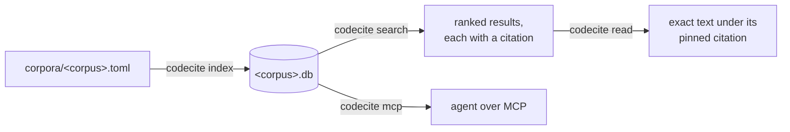

# Using codecite

How to index a corpus, query it, and hand it to an agent. `docs/design.md`
explains why codecite works the way it does; this guide covers what to type.

## Concepts

- **Corpus:** a named set of sources indexed together into one SQLite file,
  `~/.local/share/codecite/<corpus>.db` on Linux (`$XDG_DATA_HOME` moves it).
- **Manifest:** the committed TOML file, `corpora/<corpus>.toml`, that lists a
  corpus's sources, each pinned to a commit or a sha256, with its license class.
- **Citation:** the string that names one span. Every result carries one, and
  `read` turns one back into the exact text.
- **License class:** how an agent may use a source: `adapt` (adapt the code
  with attribution), `approach_only` (describe the approach, never copy),
  `quote` (normative spec text: quote exactly) or `excluded` (not indexed).



## Write a manifest

A manifest names the corpus and lists its sources. `kind` is `git` when left out.

```toml
name = "mywork"
max_age_days = 30              # queries refuse an older index unless --allow-stale

# A checkout on this machine, indexed as its HEAD plus uncommitted changes.
[[source]]
kind = "local"
path = "~/repos/myservice"
license = "Apache-2.0"
use = "adapt"
exclude = ["vendor/**"]

# A git repository at a pinned commit, kept as a partial clone in the cache.
[[source]]
url = "https://github.com/panva/openid-client"
commit = "<40-character SHA>"
license = "MIT"
use = "adapt"
include = ["lib/**"]

# A spec page, pinned by the sha256 of its bytes.
[[source]]
kind = "document"
name = "rfc9449"
url = "https://www.rfc-editor.org/rfc/rfc9449.html"
sha256 = "<64 hex characters>"
license = "IETF Trust"
use = "quote"
current = true
aliases = ["RFC 9449", "DPoP"]
```

| Field | Sources | Meaning |
| --- | --- | --- |
| `use` | all, required | `adapt`, `approach_only`, `quote` or `excluded` |
| `license` | all | The license, as people write it |
| `name` | all; required for documents | Defaults to the checkout's directory or the URL's last segment |
| `path` | `local` | The top of a git work tree; `~` expands |
| `url`, `commit` | `git` | The repository and a 40-character lowercase commit |
| `include`, `exclude` | `local`, `git` | Globs over paths |
| `url`, `sha256` | `document` | The page and the 64-character lowercase hash of its bytes |
| `current` | `document` | Exactly one pinned version of each name is current |
| `aliases` | `document` | Names people write, such as `OIDC Core` |
| `obsoleted_by`, `updated_by` | `document` | Hand-written relations to later documents |

Unknown keys are errors, and every error names the source and the field.

To pin a new or changed document, leave a placeholder hash and print the
hash each URL serves now:

```sh
codecite index mywork --print-hashes
```

## Index

```sh
codecite index mywork                      # reads corpora/mywork.toml
codecite index mywork --manifest ~/m.toml  # or any manifest file
```

Run it from a checkout of the repository that holds the manifest. The first run
downloads documents and clones git sources into `~/.cache/codecite`; later runs
work offline and rewrite only the files whose content changed. A document whose
bytes no longer match its pin, or a commit the repository doesn't have, stops
the run before anything is written.

The run ends with a summary:

```text
indexed corpus `identity` into ~/.local/share/codecite/identity.db
documents: 865 written, 0 unchanged, 0 removed
chunks: 12187 written
fetched: 0 downloaded, 39 from the cache
skipped: 39 ignored, 7 deny-listed, 4 symlink, 1 binary
elapsed: 2.12s
```

Skipped files are never indexed: what git ignores, deny-listed secrets (`.env*`,
keys and certificates), symlinks, binaries and files over 1 MiB.

## Search

```sh
codecite search identity "DPoP proof jti replay"
codecite search identity "verify proof" --language rust --limit 5
codecite search identity "nonce" --path "py/src/*" --json
codecite search identity "token_type_hint" --only spec
```

A query matches identifiers however they are written: `validate token` finds
`validateToken`, `validate_token` and `validate-token`. A chunk whose symbol is
exactly the query comes first; the rest rank by BM25, weighting symbol names
over paths over body text. Spec results come from each document's current
version.

Specs and code are ranked separately and then merged, so code that repeats a
term doesn't bury the spec section that defines it. When the query names a
symbol, code keeps the top slots and the best spec sections take the last few;
otherwise the results alternate, spec first. `--only spec` or `--only code`
searches one kind.

```text
1. rfc9449@sha256:2d8657f07291#section-11.1
   section · score 38.85 · quote · indexed 2026-10-20T22:56:30Z
     11.1. DPoP Proof Replay
```

Each result shows its rank and citation, then its kind (`function`, `class`,
`section`, `step` or `window`), symbol, score, license class and when it was
indexed, then the first lines of its text.

## Grep

`grep` finds the lines that match a regular expression, or exact text, in
everything the corpus indexed: the literal strings `search` is weak at, such
as a claim name, an error message, a header name or a parameter pattern.

```sh
codecite grep identity '"jti"' --fixed
codecite grep identity 'token_type_hint=\w+'
codecite grep identity 'invalid_dpop_proof' -i --only spec
codecite grep identity '^pub fn ' --language rust --path 'rust/src/*' --limit 20 --json
```

The pattern is [`regex` crate syntax](https://docs.rs/regex/latest/regex/#syntax)
matched against one line at a time, so `^` and `$` are a line's ends.
`--fixed` (`-F`) reads it as exact text and `--ignore-case` (`-i`) matches any
case. `--language`, `--path`, `--only` and `--limit` work as they do for
`search`.

Each match is one line: a code line cites itself (`repo@sha:path#L12`), and a
spec line cites the step or section that holds it, so `read` turns any match
back into its text. Matches come in index order, unscored: each source in
the manifest's order, its files by path, then lines. So a grep over code and
specs lists code first when the manifest does; `--only spec` keeps specs.

```text
$ codecite grep identity invalid_dpop_proof -i --only spec --limit 3
3 matches · quote · indexed 2026-10-20T22:56:30Z
1. rfc9449@sha256:2d8657f07291#section-5
   The DPoP HTTP header field MUST contain a valid DPoP proof JWT. If the DPoP proof is invalid, the authorization server i…
2. rfc9449@sha256:2d8657f07291#section-7.1
   - An error parameter ([RFC6750], Section 3) SHOULD be included to indicate the reason why the request was declined, if t…
3. rfc9449@sha256:2d8657f07291#section-12.2
   invalid_dpop_proof
```

An invalid regex is an error that says what is wrong with it, and so is an
empty pattern or one that holds a newline (`\n`), since each line is matched
on its own. Appendices, whose sections have no canonical citation yet, are
not grepped.

## Read

`read` prints the exact text a citation points at and always names the pinned
version it came from.

```sh
codecite read identity "OIDC Core §3.1.3.7 step 11"
codecite read identity "RFC 9449 §4.3" --max-lines 20
codecite read identity "identity-model@9458d60:rust/src/dpop/proof.rs#L207-L212"
```

It accepts:

| Form | Example |
| --- | --- |
| Code citation (a commit may be abbreviated) | `identity-model@9458d60:rust/src/dpop/proof.rs#L207-L212` |
| Spec citation | `rfc9449@sha256:2d8657f07291#section-4.3` |
| Spec step | `openid-connect-core-1_0@sha256:4d016752a645#section-3.1.3.7/step-11` |
| Written forms, with the manifest's aliases | `RFC 9449 §4.3`, `RFC9449 Section 4.3`, `OIDC Core §3.1.3.7 step 13`, `Core 3.1.3.7(13)` |
| A bare section, when only one current document has it | `§3.1.3.7 step 11` |
| A spec URL with its anchor | `https://www.rfc-editor.org/rfc/rfc9449.html#section-4.3` |

A citation that doesn't resolve to exactly one span is an error that lists the
candidates, never a guess:

```text
$ codecite read identity "§4.3"
Error: §4.3 names no document and is not in exactly one current document; name one: rfc6749@sha256:535362fa3b4c#section-4.3, rfc9449@sha256:2d8657f07291#section-4.3, …
```

## Check a citation

`cite` checks a spec citation: whether it names exactly one section or step in
the corpus, what that text is, and why not when it doesn't.

```sh
codecite cite identity "OIDC Core §3.1.3.7 step 13"
codecite cite identity "§4.3" --json
codecite cite identity "[OIDC Core §3.1.3.6](https://openid.net/specs/openid-connect-core-1_0.html#IDTokenValidation)"
```

It accepts every spec form `read` does, and one more:

| Form | Example |
| --- | --- |
| A Markdown link, its text a citation and its target a spec URL with its anchor | `[OIDC Core §3.1.3.7](https://openid.net/specs/openid-connect-core-1_0.html#IDTokenValidation)` |
| The same, with a bare section taking the URL's document | `[§3.1.3.7 step 13](https://openid.net/specs/openid-connect-core-1_0.html#IDTokenValidation)` |

A citation that resolves prints as `read` prints it, with its text cut to 40
lines. An older pinned version, or a document another obsoletes, says what
supersedes it:

```text
$ codecite cite identity "RFC 2616 §14.9"
rfc2616@sha256:261600000000#section-14.9
section · Cache-Control · quote · indexed 2026-10-20T22:56:30Z
superseded by rfc9110
…
```

One that doesn't resolve is still a successful check, exiting 0, with its
findings and the pinned citations it could have meant:

```text
$ codecite cite identity "[OIDC Core §3.1.3.6](https://openid.net/specs/openid-connect-core-1_0.html#IDTokenValidation)"
unresolved
anchor_label_mismatch: OIDC Core §3.1.3.6 is openid-connect-core-1_0@sha256:4d016752a645#section-3.1.3.6, but https://openid.net/specs/openid-connect-core-1_0.html#IDTokenValidation is openid-connect-core-1_0@sha256:4d016752a645#section-3.1.3.7
candidates:
  openid-connect-core-1_0@sha256:4d016752a645#section-3.1.3.6
  openid-connect-core-1_0@sha256:4d016752a645#section-3.1.3.7
```

`--json` prints the result as one compact JSON object, here for
`"RFC 9449 §4.3 step 99"`:

```json
{"candidates":["rfc9449@sha256:2d8657f07291#section-4.3/step-12","rfc9449@sha256:2d8657f07291#section-4.3/step-11","rfc9449@sha256:2d8657f07291#section-4.3/step-10","rfc9449@sha256:2d8657f07291#section-4.3/step-9","rfc9449@sha256:2d8657f07291#section-4.3/step-8"],"findings":[{"candidates":["rfc9449@sha256:2d8657f07291#section-4.3/step-12","rfc9449@sha256:2d8657f07291#section-4.3/step-11","rfc9449@sha256:2d8657f07291#section-4.3/step-10","rfc9449@sha256:2d8657f07291#section-4.3/step-9","rfc9449@sha256:2d8657f07291#section-4.3/step-8"],"section":"rfc9449@sha256:2d8657f07291#section-4.3","step":99,"type":"no_such_step"}],"resolved":false}
```

The findings are `no_such_section`, `no_such_step`, `anchor_label_mismatch`
(a link whose anchor is another section than its text) and
`ambiguous_document` (a bare § that is not in exactly one current document).
Anything else wrong is an error that exits non-zero, as `read`'s are: text that
is no citation, a malformed one, an unknown document or version, a stale index,
and a code citation, which `read` reads instead.

## List a section's requirements

`requirements` lists the normative statements that govern a spec section,
each with its pinned citation, grouped by the section that states it. Run it
before implementing or fixing anything a spec governs. It finds only what the
rules below match: uppercase BCP 14 keywords, never `must` in lowercase or
other wording, and only sections of the same document, so `read` a section
when you need all of it.

```sh
codecite requirements identity "Back-Channel Logout §2.6"
codecite requirements identity "RFC 6749 §2.3" --json
codecite requirements identity --topic "logout token validation" --document "Back-Channel Logout"
```

It takes a spec section or step citation in any form `read` does (a step asks
about its section), or `--topic` and `--document` (a name, an alias or `RFC 6749`), where the
first of the top ten spec search hits in that document's current version that
has a citation form (an appendix has none) picks the section. It
reads only what `index` stored. A rule is:

- a sentence with MUST, MUST NOT, REQUIRED, SHALL, SHALL NOT, SHOULD, SHOULD
  NOT, RECOMMENDED or NOT RECOMMENDED (MAY and OPTIONAL permit, so they don't
  count);
- a row of a claim or parameter list whose value starts REQUIRED or
  PROHIBITED, or holds one of those keywords, printed as `term: value`;
- a step: every step of the section and its subsections, and elsewhere a step
  with one of those keywords.

The sections it spans, each once, are the one asked about (`asked`), its
subsections (`subsection`), the sections of the same document it or a
subsection names (`referenced`: `Section 2.4`, but not a reference into
another document such as `Section 2 of [JWT]`, `Section 7.1 in [RFC7519]`,
`[RFC6749], Section 4.1` or `RFC 7519 Section 4`,
or a section whose title of two or more words its title holds, as §2.6
"Logout Token Validation" holds §2.4 "Logout Token"), the sections that name
it or a subsection (`referring`), and the enclosing section of each referring
subsection (`context`: RFC 6749 §3.2.1 names §2.3, so §3.2 Token Endpoint
comes too). Appendices, whose numbers have no citation form, are left out.
Each group lists MUST-level rules first, then its steps in order, then
SHOULD-level rules:

```text
$ codecite requirements identity "Back-Channel Logout §2.6"
openid-connect-backchannel-1_0@sha256:3b5c933d5269#section-2.6 · Logout Token Validation · quote · indexed 2026-10-28T04:36:10Z

openid-connect-backchannel-1_0@sha256:3b5c933d5269#section-2.6 · Logout Token Validation (asked)
  [MUST] Upon receiving a logout request at the back-channel logout URI, the RP MUST validate the Logout Token as follows:
  [SHOULD] 1. If the Logout Token is encrypted, decrypt it …
  - 2. Validate the Logout Token signature in the same way that an ID Token signature is validated, with the following refinements.
  …

openid-connect-backchannel-1_0@sha256:3b5c933d5269#section-2.4 · Logout Token (referenced)
  [REQUIRED] exp: REQUIRED. Expiration time, as specified in Section 2 of [OpenID.Core] …
  [MUST, REQUIRED, SHOULD] events: REQUIRED. Claim whose value is a JSON object … The corresponding member value MUST be a JSON object and SHOULD be the empty JSON object {}.
  [MUST NOT, PROHIBITED] nonce: PROHIBITED. A nonce Claim MUST NOT be present. …
  …
```

`--json` prints `{"citation", "title", "license_class", "indexed_at",
"sections", "truncated", "instruction"}`; each section has `citation`, `title`,
`relation` and `statements`, and each statement `citation` (its section or
step), `kind` (`sentence`, `row` or `step`), `keywords` and `text`. The
statements' text is capped at 64 KiB; past it the rest is left out and
`truncated` is `true`. A citation `read` refuses is the same error, a code
citation is an error, and a topic the document has no section on is
`no_section_on_topic`.

## Find a definition

`def` prints where a symbol is defined, from the definitions tree-sitter found
when the corpus was indexed.

```sh
codecite def identity validate
codecite def identity Client.callback
codecite def identity DPoPProof --json
```

The name is matched exactly, case and all, as the code writes it. Only when
nothing has that name, a dotted name such as `Client.callback` finds the
`callback` defined inside `Client`. A name with several definitions lists them
all, never one guess, and says it is ambiguous: source files first, then docs,
examples and tests, each in citation order, at most 50.

```text
3 definitions of callback · ambiguous
1. app@0123456789ab:src/client.rs#L4-L6 · method callback · source · adapt · indexed 2026-10-20T22:56:30Z
   pub fn callback(&self) -> bool {
2. app@0123456789ab:src/server.rs#L4 · method callback · source · adapt · indexed 2026-10-20T22:56:30Z
   pub fn callback(&self) {}
3. app@0123456789ab:tests/callback.rs#L1-L3 · function callback · test · adapt · indexed 2026-10-20T22:56:30Z
   fn callback() {
```

`read` a definition's citation for its whole text. `--json` prints
`{"symbol", "ambiguous", "total", "results"}`; each result also carries
`providers` and `confidence`. A name nothing defines is an error that lists
the names differing from it only in case, `_` or `-`:

```text
$ codecite def identity callBack
Error: the corpus defines no symbol `callBack`; did you mean: callback
```

## List corpora

```sh
codecite corpora
```

```json
{"corpora":[{"age_days":0.0,"corpus":"identity","indexed_at":"2026-10-20T22:56:30Z","max_age_days":30,"size_bytes":41594880,"sources":40,"stale":false}]}
```

## Connect an agent

`codecite mcp` serves MCP over stdio. stdout carries only protocol messages;
it prints one line to stderr naming the data directory. Register it with
Claude Code:

```sh
claude mcp add codecite -- codecite mcp
```

The server's tools, `corpora`, `search`, `grep`, `definition`, `read` and
`requirements`, return the same JSON as the CLI commands `corpora`, `search`,
`grep`, `def`, `read` and `requirements` print (with `--json` for all but
`corpora`), byte for byte, so anything an agent sees can be reproduced from a
terminal. `requirements` takes `citation`, or `topic` and `document`; any
other mix is an `invalid_arguments` tool error. The server's instructions tell
the agent to call it on the governing section before implementing or fixing
anything a spec governs. `search`, `grep`, `definition`, `read` and
`requirements` take an optional `corpus`; left
out or empty, it is the only corpus in the data directory. `limit` is at most
50 for `search` and `grep`, and `max_lines` at most 500, for the tools and the
CLI alike. Text is also
capped in bytes, so that one minified or generated line cannot flood an
agent's context: a search snippet holds at most 4 KiB (after its 40-line
cap), a grep match's line at most 4 KiB, and `read` text at most 64 KiB
(after `max_lines`). A cut keeps an
exact prefix of the lines, joined with `\n` line endings and ending on a
character boundary, and adds no marker to it; instead a search result's
`snippet_truncated`, a grep match's `truncated` and a read's `truncated` are
`true`, and a truncated
`quote` read's `instruction` says the quote is partial. The citation still
names the full lines, and reading it again returns the same capped text. An unknown corpus, a stale index, a
citation that isn't in the corpus or a symbol nothing defines is a tool error whose structured content is
`{"error": {"kind", "message", "candidates"}}`; each tool's output schema
admits both its result and this error. A `read` of a spec, whose
license class is `quote`, carries an `instruction` to quote the text exactly
with its citation.

## The identity corpus

`corpora/identity.toml` indexes identity-model from `~/repos/auth/identity-model`
and the 39 OAuth, OpenID and FAPI documents it cites, with the older versions
it has cited pinned beside the current ones. Clone identity-model there, then
from a codecite checkout:

```sh
codecite index identity
cargo test -p codecite --test identity -- --ignored --nocapture   # its lookup check
```
