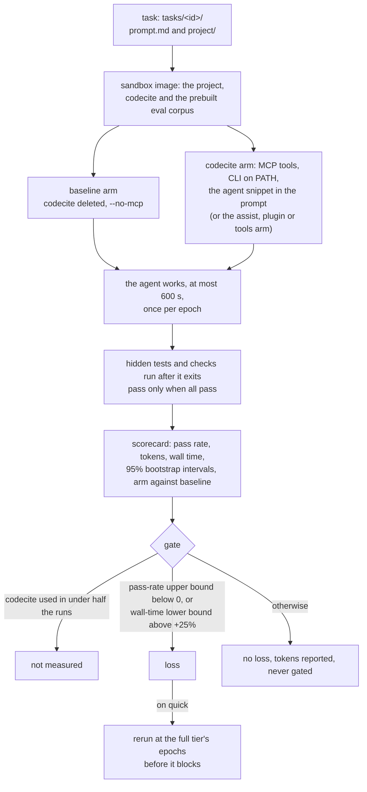

# evals

codecite only earns its place if an agent does better with it than without
it, so it is measured, not assumed. Three benchmarks keep it honest (see
[Evaluation plan](../docs/design.md#evaluation-plan) in the design):

- **A/B agent eval** (`inspect/`): the same coding agent does the same task
  twice, in a **baseline** arm and in a **codecite** arm with codecite's
  `search`, `read` and `requirements` as native tools, the `codecite` CLI on `PATH` and a
  prebuilt corpus. Hidden tests and deterministic checks
  score both. Runs on [Inspect AI](https://inspect.aisi.org.uk/).
- **History benchmark** (`history/`): queries mined from merged PRs in the
  owner's repositories, scored against a plain `git grep` ranking; CI runs it
  on every PR. See below.
- **Retrieval benchmark** (`retrieval/`): labelled queries run through
  `codecite-bench`; CI runs it on every PR.

## History benchmark

The question an agent asks most is "where does this change go?". Every merged
PR answers it: the PR's title, and the issue it closes as it was asked, are
the question, and the files it modified are the answer. Nobody writes these
labels, so nobody can tune them toward one corpus.

- **Mined** by `uv run codecite-history-mine OWNER/REPO --clone DIR` into
  `history/<repo>/queries.toml` and `manifest.toml`. Up to 40 of the newest
  merged PRs by a person (no bots, no release PRs) that modified 1–20 files
  are sampled. The repository is pinned at the oldest one's parent, so every
  answer file is in the index. Lockfiles and changelogs are no answer, nor is
  a hub file that at least 3 and more than a quarter of the sampled PRs
  changed (a design doc, a manifest), since naming it would beat any search.
  A file that didn't exist at the pinned commit is dropped. `history-title` queries are a PR's
  title. `history-issue` queries are its closing issue's title and first
  paragraph, cut to 400 characters.
- **Frozen.** `codecite-eval-frozen` refuses a change to a mined file unless
  `queries.toml`'s `# version:` moves up, which only remining with changed
  rules (`history.VERSION`) does. Never edit them by hand.
- **Scored** at file level: a result counts when it is in an answer file.
  `codecite-bench --grep <clone> --commit <sha>` ranks the same queries with
  `git grep` instead: files by how many of the query's words they hold, then
  by matching lines. That is an agent with grep and nothing else. For
  codecite, a file-labelled query ranks distinct files (each file's first
  result from a 50-deep search), so both engines are judged on 10 files.
  `--popular` ranks without searching at all: the files the other PRs changed
  most. It is the floor both engines must beat. The scorecard pools each
  repository's classes in an `all` row, which is the one to judge by, since
  some classes hold only a few queries.
- **Cost** (`codecite-bench --cost <checkout>`) is a second table in the
  scorecard, `## Cost per query`. For each query with words in it, it runs
  `codecite search` as an agent does (default limit, the human output) and
  `rg -n` and `rg -l` over the pinned tree with the same words as whole
  words in any case, three times each, and keeps the fastest run. The table
  gives the median output bytes and median time per query, with the 90th
  percentile of the time in parentheses. A query with no words is skipped
  for both. The byte comparison is uneven by design: codecite prints its
  default 5 hits, `rg -n` every matching line, uncapped, so `rg -l` is the
  closer comparison. And they see different trees: `rg` searches the pinned
  tree as `git archive` extracts it, with its defaults, so hidden files are
  skipped and, outside a git checkout, no `.gitignore` applies; codecite
  searches what the manifest indexed. A missing `rg` fails the cost step
  (`--rg`, or `RG` for `run.sh`, names the program; `--rg` needs `--cost`).
- **Run** with `history/run.sh [repo ...]`, after `cargo build --release
  --locked -p codecite -p codecite-bench`, with ripgrep installed. It writes
  each engine's report, the cost report and `history/results/scorecard.md`.
  A repository whose cost step fails keeps its recall rows; the failure,
  from `<repo>.cost-failed.txt`, is a row of the cost table, and it leaves
  the exit status alone. A cost report that measured no query (all were
  skipped) shows as `no measured queries`.

The rule from the general-purpose design: a ranking or indexing change that
loses on any repository doesn't merge.

`codecite-bench --assist` times `codecite assist` instead: a grep call per
labelled query with its text as the pattern and one with its first word as
a symbol, three runs each, the fastest counting. It reports the median and
95th percentile time and the share of calls that printed a block.
`experiments/assist-latency/` runs it on the retrieval corpus against a
p95 guardrail of 150 ms.

## Layout

| Path | What |
| --- | --- |
| `src/codecite_evals/` | The `codecite-evals` package that `uv sync` installs: `task.py` (the code tasks: one sample per arm, the agent in a Docker sandbox, the scorer), `claude_code.py` (Claude Code as the agent, for `claude-code/` models; any other model runs pi), `scrub.py` (deletes logs holding the Claude token before CI uploads them), `spec_task.py` (the spec-question task: one sample per question per arm, on the same agents), `report.py` (the scorecard, or the calibration table), `frozen.py` (the frozen-task check), `assist.py` (the assist arm's hook on the agent's searches), `replay.py` (mines past issues into replay tasks), `history.py` (mines merged PRs into the history benchmark's queries), `_registry.py` (registers the tasks with Inspect) and `config.py` (where every file below is found) |
| `tests/` | Unit tests for the task's agent, the scorecard, the frozen-task check and the config; no model key or Docker needed |
| `inspect/prepare.sh` | Stage the sandbox image's build context in `inspect/build/` for one task (`prepare.sh <task-id>`, default `fastapi-middleware`) |
| `inspect/Dockerfile`, `inspect/compose.yaml` | The sandbox image and the IdP beside it, on a network with no route out but the proxy |
| `inspect/compose-offline.yaml` | The sandbox without the IdP, for a task that needs none (spec-questions) |
| `inspect/proxy/` | The sandbox's one way out: an HTTPS proxy that lets through api.anthropic.com alone, for Claude Code |
| `inspect/pi-models.json` | Points pi at Inspect's agent bridge |
| `inspect/panel.sh` | Run one tier (`quick` or `full`): every model in one Inspect process, then the report |
| `tasks/<id>/` | A task: `task.json` (with `frozen_at` once frozen), `prompt.md`, starting `project/`, `hidden/` tests, `checks.py`, `reference/`, and `check.sh`/`planted.sh` to prove the task and checks are sound |
| `tasks/house-rules/` | The size-dial task: `corpus/{s,m,l}.toml` (its corpus at each size), `rules.toml` (the rule layer it exercises, each rule's kind, checks and citation), `probe.toml` (the memorization probe), `reference/solution.patch`, and `planted.py` with the rule breaks `planted.sh` plants |
| `tasks/spec-questions/` | The spec-question task: `questions.toml` (labelled questions with closed answers, checked against the index by `src/codecite_evals/spec_questions.py`), `prompt.md`, the in-sandbox scorer `score.py`, and `check.sh`/`planted.py` to prove the scorer sound |
| `fixtures/node-oidc/` | The IdP the fastapi-middleware hidden tests take tokens from |
| `retrieval/` | The retrieval benchmark's queries and corpus manifest |
| `history/` | The history benchmark: queries mined from merged PRs, one directory per repository, `run.sh`, and `results/` |
| `tasks/_replay/` | `check.sh`, which proves a replay task sound |

## Tasks

- **`fastapi-middleware`**: protect a FastAPI app with identity-model's
  `TokenValidationMiddleware` and `CurrentUser`. The hidden tests take real
  tokens from node-oidc-provider. The corpus is identity-model. The prompt
  names the symbols, so it tests little search.
- **`client-auth-uri`**: a FastAPI service's hand-rolled token endpoint takes
  client credentials from HTTP Basic, the form body and the query string. The
  prompt says only that a security review flagged it: fix what the OAuth spec
  forbids, keep what it allows, and cite the section in a comment. The answer
  is RFC 6749 §2.3.1: credentials MUST NOT be in the request URI, HTTP Basic
  MUST be supported, and the form body is allowed. The hidden tests reject
  query-string credentials, even valid ones, with `invalid_client` or
  `invalid_request` (both readings of §5.2); reject HTTP Basic plus a
  `client_secret` in the body, since a client MUST NOT use more than one
  authentication method in a request (§2.3); refuse a body that repeats
  `client_id` (§3.2, an `invalid_request` under §5.2); and
  still issue tokens over Basic and the form body; an agent that removes too
  much fails. `checks.py` passes only when a comment or docstring in `app/`
  cites §2.3.1, §2.3 or §3.2 of RFC 6749, the sections of its three fixes
  (`rfc6749#section-2.3.1`, `RFC 6749 §2.3` or `Section 2.3.1 of RFC 6749`,
  alone or in a list of sections). The agent may
  add Python tests of its own (`test_*.py`, `*_test.py`, and a `conftest.py` or `__init__.py` beside them), but no `conftest.py` at the project root. The corpus is identity-model plus the spec
  documents of `retrieval/identity-bench.toml` (`task.json`'s
  `corpus.documents`), and the codecite arm's note says so. It needs no IdP,
  so `planted.sh` runs the hidden tests itself, and `check.sh` just runs it.
- **`backchannel-logout`**: a relying-party app's hand-rolled
  `POST /backchannel-logout` checks only a logout token's signature and
  audience. The prompt says only that the endpoint accepts tokens it should
  reject and must conform to the spec it implements; it names no
  identity-model symbol and no spec section. An agent can find identity-model's
  logout-token validation and call it, or find Back-Channel Logout 1.0 §2.6
  and implement it; both pass. The corpus is all of identity-model plus the
  spec documents of `retrieval/identity-bench.toml`, at their pinned commit
  and `sha256`. Hidden tests mint logout tokens with a test key and serve
  discovery and JWKS from a stub in their conftest, so the task needs no IdP:
  a valid token (with `sub` and `sid`, `sid` only, `sub` only, `aud` as a
  list) ends the session, a `sub`-only token ends every session of that `sub`
  and a `sid` ends only its own, and a bad signature, wrong `iss` or `aud`, a
  `nonce`, a missing or malformed `events` or event member, neither `sub` nor
  `sid`, a missing `iat`, `jti` or `exp`, or an expired token is rejected with
  400, an empty body or a JSON one with an `error` member (§2.8), and leaves
  the session alone. The spec as pinned is errata set 1, which makes `exp`
  REQUIRED and the event member's value a JSON object (§2.4): identity-model's
  `validate_logout_token` checks neither, so calling it is not enough
  (`planted.sh`'s `library-only`). `checks.py` fails a new
  dependency, a change outside `app/` other than docs and the agent's own test
  modules, and a provider URL written into `app/`. Its `reference/` holds a
  solution that calls identity-model and adds those two checks, a hand-written
  one, and identity-model alone (`library-only`, which fails).

- **`house-rules`** (#160): knowledge the model can't have. The project is
  identity-stack at the commit where its rule layer (identity-stack#512) and
  its functional domain core (identity-stack#513) had merged, with about forty
  house rules in BCP 14 terms spread over `docs/conventions.md`, eight ADRs
  (ADR-0002 superseded by ADR-0005, both in the tree) and the docstrings of
  its own helpers (`app/knobs.py`, `app/outbound.py`, `app/logbook.py`).
  `rules.toml` lists them, each with its kind (`house`, an arbitrary house
  choice; `habit`, against common habit, such as no `os.environ`, no raw
  `httpx`, no `logging.getLogger`; or `control`, best practice), what decides
  it, and a `codecite read` citation. The prompt is a feature request in the
  backend, naming no helper and no rule: import a tenant's roles from a
  partner catalogue over HTTP (`POST /api/roles/import`, a new
  `PARTNER_CATALOGUE_URL` setting, 502 on a failed or slow catalogue,
  owners and admins only), and make every role name a lowercase slug. The
  hidden tests drive the real app over a SQLite file per test with a stub
  catalogue, and one calls `access.role_name` directly, with no database: it
  passes only when the slug rule is decided in the domain, not in the
  service or the request model. `checks.py` runs identity-stack's own
  enforcement as the start had it (Ruff's bans, import-linter's contracts and
  the house-rule tests, laid over a copy of the agent's tree so loosening
  them doesn't help: every other ruff.toml, nested pyproject.toml, pytest or
  tox ini, setup.cfg, .importlinter and conftest.py the agent left is dropped,
  as is any linked directory under `backend/`,
  the tools are pointed at the start's pyproject.toml, and Ruff ignores
  `# noqa`) plus its own reuse checks (no settings, HTTP or logging
  library in place of `app.knobs`, `app.outbound`, `app.logbook`; new routes
  answer through `result_to_response` and take the tenant from
  `get_tenant_id`). A run passes only with the hidden tests passing and no
  violation of a MUST rule; the control rules and best-practice checks
  (pyflakes, bare `except`, `print`, the agent's own unit tests) are reported
  apart, never gated. The agent runs as root in the sandbox, so the scorer
  trusts nothing it could rewrite: it reads the start tarball the image built
  (`/opt/project-start.tar`) back to the host and checks it against
  task.json's `corpus.start_sha256` (which `check.sh` recomputes from the
  pin), and runs the hidden tests and checks with tools from a fresh
  environment built offline from that start's lockfile (`score_setup`), not
  the agent's `.venv`. A mismatch fails the sample as `scorer-start`. All of
  `/score` is cleared before the scorer writes into it. The checks run the
  agent's code as root (the house-rule tests import it), so after them any
  process left running is killed (sparing the container's init and main
  process) and the start and its venv are laid out
  again from the bytes verified on the host,
  and the hidden tests are written only then, just before they run, with
  pytest's config pinned to the hidden directory (`-c /dev/null`,
  `--rootdir`, `--confcutdir`). They pass only when pytest exits 0 and its
  junit report, read back on the host, names every test in `hidden/` as
  passed, so code that ends their process early with status 0 fails them.
  Every pytest run starts with `python -P`, so
  a `pytest.py` the agent leaves can't stand in for pytest, and a house-rule
  test report that disagrees with pytest's exit status fails every
  house-rule test. Each tool in `checks.py` has its own timeout, and the
  scorer's timeout on `checks.py` covers their sum, so a slow control can't
  lose the gated results. What stays open is an agent that rewrites the
  system tools themselves (`uv`'s cache, `python3`, `tar`), leaves a process
  running to tamper after it exits, or has the code the house-rule tests
  import forge both pytest's exit status and its report; nothing short of
  scoring in a second container closes that.
  `checks.py`'s §12 and §16 checks cover the route handlers the start had
  too: one that gains an HTTPException, a hand-built response or a `dct`
  read breaks the rule. `planted.sh` plants twenty-six rule breaks and
  hand-rolled helpers on the reference (`reference/solution.patch`) and shows
  each caught. `probe.toml` holds the memorization probe: three questions
  only the rule layer answers, for a model asked with no files; no runner
  asks them yet.

  **The size dial.** One prompt, one set of hidden tests and checks, at three
  corpus sizes, each a manifest under `corpus/` with every git source pinned
  by full commit: `s` is identity-stack alone; `m` adds identity-model and the
  identity spec documents; `l` adds public FastAPI and auth repositories
  (full-stack-fastapi-template, fastapi's code, examples and English docs,
  fastapi-users, authlib, pydantic-settings), with helpers that do almost
  what identity-stack's do and examples that break its rules. Both arms see
  the same bytes: `prepare.sh` stages the project in `/work/project`, the
  other git sources in `/opt/corpus/<name>` and the current documents in
  `/opt/specs`, and the image indexes the manifest itself, so citations name
  the pinned commits. The image build resolves every rule's citation with
  `codecite read` and fails if one doesn't. `-T corpus=s|m|l` picks the size
  (default `m`), and it must match the staged image, which the sample checks
  before the agent starts; the scorecard names the task `house_rules@<size>`,
  a table per size. Stage and run a size with `CORPUS=<size>` for both
  `prepare.sh` and `panel.sh`, or dispatch the Evals workflow with `corpus`.
  Calibration is gated at `m` only; `s` and `l` are reported.

- **`spec-questions`**: one question about the identity specs per sample,
  asked in an agent's words rather than the spec's (`questions.toml`, from
  the `spec-plain` and `spec-requirement` classes of
  `retrieval/queries.toml` or labelled anew; see `tasks/spec-questions/`).
  The current spec documents of `retrieval/identity-bench.toml` sit in
  `/opt/specs/<document>.html` in both arms, copied from the bytes codecite
  indexed and checked against their pinned `sha256`; the `eval` corpus is
  identity-model plus those documents, so codecite's citations name the same
  documents as the labels. The agent writes `answer: <value>` and `section:
  <document>#section-<number>` to `/work/answer.txt`. `score.py` passes a
  sample only when the answer is one of the question's accepted forms
  (ignoring case, quotes and a final full stop) and the section is an
  accepted one; a step of an accepted section counts, and codecite's
  `@sha256:` pin is allowed. A missing file, a third line or prose fails.
  The task has no project and no IdP: its sandbox has no network at all
  (`inspect/compose-offline.yaml`). One epoch is a run per question, so its
  `task.json` sets 1 epoch on the quick tier and 3 on the full.

- **Replay tasks** (`replay-<repo>-<pr>`, `"kind": "replay"`): real past
  work. The prompt is an issue as it was asked, the project is its repository
  at the merged PR's base, the merge commit's first parent (not the PR's
  `baseRefOid`, which can lag it and bring other PRs' edits), and the hidden
  tests are the test files that PR added or changed, at its merge commit.
  The `eval` corpus is that same tree. `codecite-replay-mine OWNER/REPO
  --clone <dir>` (`src/codecite_evals/replay.py`) lists merged PRs by a
  person that close an issue, change source and add tests kept apart from it
  (Python `tests/` and `test_*.py`, Go `*_test.go` without `TF_ACC`
  acceptance tests, Rust `crates/<crate>/tests/*.rs`, JS/TS `*.test.*`),
  newest first, skips any PR that already has a task, and any rebase-merged
  PR of several commits, whose merge's first parent already holds its
  earlier commits: one whose merge commit has one parent and keeps the PR's
  last commit's author date or subject, which a squash doesn't, or whose
  merge commit doesn't change every file the PR did. It writes up to
  `--max` of them as task directories: `task.json` (the base, the hidden
  tests, the test `data`, the language, the `setup` and `test` commands and
  the `workdir` they run in), `prompt.md`, `hidden/`, `reference/fix.patch`
  (the PR's non-test diff) and `check.sh`. Test data is any file the PR
  changed under `testdata` or a Jest `__snapshots__` directory, any `.snap`
  file, and under a `tests`, `test` or `__tests__`
  directory any non-code file and anything in a `fixtures`, `__fixtures__`
  or snapshot directory below it, code or not; a `fixtures` or `snapshots`
  directory outside the tests is source: it goes into `hidden/` with the tests and is
  overlaid with them, but only the test files are named to the runner. A
  Rust hidden test is a file in a `tests/` directory beside a `Cargo.toml`
  at the merge; one in a `tests/` module inside a crate's `src/` is library
  code and goes in the fix. A Rust test target is a file directly in that
  `tests/`; one deeper (`tests/common/mod.rs`) is overlaid but is no
  `--test`, and a Rust PR with no target is skipped, since a bare `cargo
  test` would run the whole package. When the hidden tests call names the
  fix adds and the base lacks, the prompt ends with a "Names the tests use"
  section giving each one's file, doc comment and definition line, since an
  agent can't discover a name that doesn't exist yet. That comment is the
  mined PR's text, so only its last five lines reach the prompt, each cut
  to 200 characters and stripped of Unicode format and control characters
  (zero-width, bidi overrides), inside a fence no backtick run in them can
  close. The issue's title and body lose the same characters; read
  the section by hand before the task freezes, as with anything added by
  hand. What else the tests
  pin that the issue leaves open (an exact message, say) is added by hand
  under "What the tests check" before the task freezes. The miner keeps a
  task only when `check.sh` shows the hidden tests fail at the base and pass
  with the fix. It never rewrites a task directory, and a write that fails
  leaves none behind: `--pr <n>` mines a PR again, as one past its highest
  `-v<n>` there (`replay-<repo>-<pr>-v2` after the bare id). An id is
  unique only among the task directories that exist: once a task is
  deleted, its id can be issued again. A `--pr` that names no replayable
  PR among the 500 newest is reported, not silently dropped. The project the agent sees is
  `git archive` of the base in a fresh one-commit repository, so no later
  history reaches it; `hidden/` is overlaid on the agent's tree after it
  exits and only those files run, offline, with the dependencies warmed into
  the image. `check.sh` and `prepare.sh` read the repository from
  `REPLAY_REPO`, by default the history benchmark's clone in
  `~/.cache/codecite/history/<repo>`. A replay task has no registered name:
  it runs as `codecite_evals/ab -T task_id=<id>`, which `panel.sh` does for it.
  Its agent has the same 600 s as any task's, so a PR too broad to replay in
  that time is cut to the part its hidden tests check, by hand, before the
  task freezes. A failing sample's score metadata keeps the tail of the
  hidden tests' stdout and then of their stderr (`tests_tail`), where a
  failed build says why.

Each task's `check.sh` proves it is well-formed; `backchannel-logout`'s needs
only uv and an identity-model checkout, `house-rules`' only git, uv and the
network (it fetches identity-stack at its pin unless `IDENTITY_STACK_REPO`
names a clone that has it), and `spec-questions`' only python3
(it runs `score.py` on every question's reference answer and on planted
wrong ones), and a replay task's only its repository and the language's
toolchain. CI runs them (`eval-task`):

```
IDENTITY_MODEL_REPO=~/repos/auth/identity-model evals/tasks/backchannel-logout/check.sh
```

Each task is registered in `src/codecite_evals/_registry.py` and runs as
`codecite_evals/<task>` with `_` for `-`. The sandbox image holds one task's
project and corpus, so `inspect/prepare.sh <task-id>` stages it before the
image is built; after switching tasks, rebuild it (`docker compose -f
inspect/compose.yaml build`). `panel.sh` runs the task `TASK_ID` names
(default `fastapi-middleware`).
Every task takes `-T arms=baseline` to run the baseline arm alone, a
calibration (see below). `-T arms=tools` runs baseline, codecite and codegraph
in one run on the same host (`docs/superpowers/specs/2026-11-21-codegraph-arm-design.md`).
The codegraph arm gets a mirrored prompt note on coding tasks, CodeGraph 1.6.4
baked into the image and indexes built at image build time over the sources
codecite's `eval` corpus indexes, no more; every other arm strips CodeGraph
and its indexes, and every arm without codecite strips codecite's index with
its binary. `used` counts each arm's own tool. CodeGraph comparisons are
reported, never gated, and the direct CodeGraph-vs-codecite comparison is
`not measured` if either tool was used in fewer than half its usable runs.
The codecite-vs-baseline gate is unchanged.

## The gate run and the rerun

The A/B eval runs at one of two tiers. They share the task, the scorer, the
report and the gating panel; only the number of epochs differs, and the
OpenRouter panel when it is on. `quick` is the gate run; `full` is the rerun of
a pair that lost on `quick`, and a loss there blocks (`docs/design.md`,
Success criteria).

One A/B run, from a task to the gate's verdict:



The **gating panel** always runs: Claude Code
(`src/codecite_evals/claude_code.py`) on claude-haiku-5-5, claude-sonnet-5-5
and claude-opus-5-5, billed to the Claude subscription behind
`CLAUDE_CODE_OAUTH_TOKEN`. The **OpenRouter panel** is pi on the models below,
billed per token to `OPENROUTER_API_KEY`, and runs beside it only when
`OPENROUTER=1` (in CI, only a dispatch with the `openrouter` input); its verdicts are reported, never part of the gate. The
two agents' results are reported apart, a row per model each:
`claude-code/<model>` and `openrouter/<model>`.

| Tier | OpenRouter panel | Epochs per sample | Use it |
| --- | --- | --- | --- |
| `quick` | claude-haiku-5.5, claude-sonnet-5.5, gpt-6.1-sol | 5; spec-questions 1 | the gate run, on a PR that touches indexing, search, ranking or the CLI's output |
| `full` | all 9 models | 10; spec-questions 3 | the rerun of a pair that lost on `quick`, before it blocks |

A code task has one sample per arm, so its runs per arm are its epochs. The
spec-question task has one sample per question per arm, so its runs per arm
are questions × epochs: 59 on the quick tier, 177 on the full.

A replay task runs on the gating panel alone: OpenRouter is skipped for it
even when switched on. A task's
`task.json` sets its own epochs (`"epochs": {"quick": 1, "full": 3}`), and
`EPOCHS` overrides both.

At 5 runs per arm the intervals are wide, so a quick loss is rerun at the full
tier's epochs (the table's, or the task's own) before it blocks. The quick OpenRouter panel's third model is the fastest pi model by round one's medians; change it in
`panel.sh` when a full run's medians say another is faster.

### In CI

`.github/workflows/evals.yml` runs both tiers. It is advisory, like `bench`,
and never a required check.

- **Quick, the gate run:** add the `eval` label to a PR. The tier runs once, one job per
  task (`fastapi-middleware` and `spec-questions`, the eval job's matrix),
  and their scorecards go to one PR comment, updated in place, a table per
  task. Pushes don't rerun it: to run it again on a new head, take the label
  off and put it back, or dispatch. Fork PRs never run: they get no secrets.
- **Full, the rerun:** after a quick loss, run the workflow by hand
  (Actions → Evals → Run workflow) with `tier: full`, the losing `task` (and `corpus`, for a size-dial task) and `arms` (`ab`, the default; `aa`;
  `assist`; `tools`; or `baseline` to calibrate; see below). Its scorecard goes to the job summary.
  To finish a run that stopped part way, run it again with `resume` set to
  that run's id: it downloads that run's logs and reruns only their missing
  samples with `inspect eval-retry`.
- **A/A:** dispatch with `arms: aa` to run an A/A round at either tier, and
  `epochs` to run more epochs than the tier's own (a quick tier at more than
  its 5 epochs gets the full tier's time limits).
- **OpenRouter:** off unless a dispatch asks for it with `openrouter: true`.
  A labelled PR's run never bills OpenRouter.

### Spend limits

The OpenRouter budget once ran out because evals ran on nearly every commit.
These limits keep that from happening again (#297):

| Limit | Default | Where it's set | To go past it once |
| --- | --- | --- | --- |
| Eval runs started in any 24 hours | 6 | repository variable `EVALS_DAILY_MAX` | dispatch with `ignore_daily_cap: true` |
| OpenRouter | off | only the `openrouter` dispatch input | dispatch with `openrouter: true` |
| A PR's runs | one per `eval` label | the workflow's trigger | take the label off and put it back |

The `budget` job counts the runs whose eval job started, so runs skipped by
another label, and runs it refused, don't count. Over the cap it fails with
the reason in its summary, and the eval job is skipped.

The only hard dollar limit is outside the repository: the eval OpenRouter
key's credit limit, $400 a month (its validation caps it at $500). It is set
in Terraform in the private oss-admin repository, so change it there: a change
made in the OpenRouter dashboard is reverted on the next apply.

The job builds codecite, fetches identity-model at the task's pinned commit
and caches the three sandbox images (the sandbox, the IdP and the proxy),
keyed on a hash of their build contexts (which hold the codecite binary and
the identity-model commit), so an unchanged binary doesn't rebuild. It reads
the `CLAUDE_CODE_OAUTH_TOKEN` secret, and `OPENROUTER_EVAL_API_KEY` only when
OpenRouter is on. The two panels run in separate Inspect processes, so pi's
never holds the Claude token. Claude Code's shell can read it, so before
uploading, `python -m codecite_evals.scrub` deletes any log holding a run of
it, as it is, reversed, hex, base64 (line-wrapped or not) or URL-encoded, and
any log it can't read through, and fails the job; nothing uploads unless it
passes. Error text that holds it is withheld from the job's console. A copy
the agent deliberately disguised (compressed, encrypted) would get past the
scrub, as would one the agent sent out through api.anthropic.com itself (the
proxy checks only the host), so a token kept for evals alone is the safer
secret. The Inspect logs, with the scorecard, upload as the
`eval-logs-<tier>-<task>` artifact (`eval-logs-<tier>-aa-<task>` for an A/A
round, `eval-logs-<tier>-assist-<task>` for the assist arm,
`eval-logs-<tier>-tools-<task>` for the tools arms,
`eval-logs-calibration-<task>` for a calibration; a size-dial task's `<task>`
is `<task>-<size>`, as `house-rules-m`).

## A/A rounds

An A/A round runs the task with two baseline arms, `baseline-a` and
`baseline-b`, with the same prompt and the same sandbox. Whatever separates
them is noise, so its intervals say how wide the A/B intervals would be with
no effect at all, at that number of epochs. `-T arms=aa` selects it (the
default, `ab`, is baseline against codecite); `ARMS=aa inspect/panel.sh quick`
runs a tier that way into `inspect/logs/<tier>-aa/<task>/`. The scorecard heads the
round as A/A and gives it no verdict: it names each measure whose interval
noise alone pushed past the 5% margin.

## The assist arm

`-T arms=assist` runs baseline against an `assist` arm, where codecite reaches
the agent only through `codecite assist` on its own searches (#162,
`docs/usage.md`): the binary stays in the sandbox at `/opt/codecite` but off
`PATH`, with no MCP config and no note in the prompt, so the prompt is
baseline's. `src/codecite_evals/assist.py` holds the hook, one Python script
for both agents since the sandbox has no `jq`: Claude Code runs it as a
PostToolUse hook on `Grep|Glob|Bash` from settings passed with `--settings`, and
pi's extension, loaded alone with `-e`, hands it the same payload for `grep`,
`find` and `bash`. A shell command reaches `codecite assist` only when it
names a search program (`grep`, `rg`, `find`, `fd`, …), and `assist` reads the
search out of it. Each search appends `{"tool", "bytes"}` to
`/tmp/codecite-assist.jsonl`, which the agent reads after the run into the
sample's store. A run counts as having used codecite when the hook added at
least one block, and the scorecard adds a table of the hook's calls, blocks
and bytes per run, with bytes / 4 as an estimate of the tokens added.
`ARMS=assist inspect/panel.sh quick` logs to `inspect/logs/<tier>-assist/<task>/`;
on CI, dispatch with `arms: assist`.

## The plugin arm

`-T arms=plugin` runs baseline against a `plugin` arm: Claude Code with the codecite plugin (`plugins/codecite`: the skill, the MCP server and the session-start hook) loaded with `--plugin-dir /opt/codecite-plugin`. `src/codecite_evals/plugin.py` copies the plugin's files into the sandbox. `codecite` stays on `PATH`, since the plugin's MCP server and hook run it, and `CODECITE_CORPUS=eval` names the corpus. The prompt is baseline's: the skill and the session note are the plugin's own. On CI, dispatch with `arms: plugin`.

## The tools arms

`ARMS=tools inspect/panel.sh quick` logs to `inspect/logs/<tier>-tools/<task>/`;
on CI, dispatch with `arms: tools`. These paths and artifacts are distinct
from the default A/B logs, including on retry or resume.

## The scorecard

`codecite-eval-report` prints three tables per task (a calibration prints one):

- **Per arm:** runs, how many used the arm's tool (`used codecite`, or `used tool` with the tools arms), pass rate, failures, timeouts, sandbox errors, median
  total tokens and median wall time, and the model's verdict.
- **From the transcripts:** the median turns (model calls that returned),
  output tokens, model time (the sum of the calls' generation times), other
  time (wall time less model time: tools, sandbox and waiting), and decode
  rate (output tokens per second of model time), normalised time (wall time
  with the model time recomputed at the model's decode rate over both arms,
  so a slower host for one arm drops out), with the upstream providers
  OpenRouter says served the calls, counted. A provider or decode-speed gap
  between arms shows here. The provider is in each call's raw response,
  which Inspect keeps only with `--log-model-api` (`panel.sh` passes it);
  calls without one count as `not logged`.
- **Intervals:** the 95% bootstrap interval of every measure, second arm
  against the first. Pass rate and time get `*` when the interval lies wholly
  past the gate's line on either side of 0 (0 points for pass, 25% for time),
  where the gate sees a sure difference; tokens never do; the other measures
  get it when they reach past 5% either side of 0.

One gate judges every task (`docs/design.md`, Success criteria), and the
scorecard states it above each task's tables: pass rate loses when its
interval's upper bound is below 0, any sure drop; wall time loses when its
lower bound is above +25%; tokens get an interval but never lose. A pi
model's verdict ends `reported, not gated`. The `"gate"`
key that older replay tasks' `task.json` carry is ignored. Logs whose samples kept no model events leave the
transcript measures blank.

## Running the A/B eval locally

Needs Docker, [uv](https://docs.astral.sh/uv/), a release build of codecite
and an identity-model checkout (`IDENTITY_MODEL_REPO`, default
`~/repos/auth/identity-model`).

```
cargo build --release
evals/inspect/prepare.sh             # or: evals/inspect/prepare.sh spec-questions
cd evals
uv sync --locked
export CLAUDE_CODE_OAUTH_TOKEN=...  # from `claude setup-token`
uv run --locked inspect eval codecite_evals/fastapi_middleware --model claude-code/claude-haiku-5-5 --epochs 2
inspect/panel.sh quick               # or: TASK_ID=spec-questions inspect/panel.sh full
# pi on OpenRouter as well, billed per token:
set -a; . ~/.config/codecite/evals.env; set +a
export OPENROUTER_API_KEY="$OPENROUTER_EVAL_API_KEY"
uv run --locked inspect eval codecite_evals/fastapi_middleware --model openrouter/anthropic/claude-haiku-5.5 -M strict_tools=false --epochs 2
OPENROUTER=1 inspect/panel.sh quick
uv run --locked codecite-eval-report --tier quick
```

The package registers its tasks with Inspect through the `inspect_ai` entry
point, so Inspect runs them by name from any directory: `codecite_evals/ab`
takes the task's id (`-T task_id=<id>`) and its arms (`-T arms=ab|aa|baseline|assist|tools`),
and each registered task also runs by its own name.
`codecite-eval-report` is the scorecard's command. Both find `tasks/`,
`inspect/compose.yaml` and `inspect/logs/` through
`src/codecite_evals/config.py`: under this `evals/` directory, or under
`CODECITE_EVALS_DIR` when it is set.

The unit tests in `tests/` run offline, and CI runs them on every PR:
`uv run --locked pytest`.

Each tier's logs land in `inspect/logs/<tier>/<task>/` (gitignored), with the
last scorecard in `scorecard.md`. `codecite-eval-report --tier <tier>` reads
every task's logs and prints a table for each, so tasks never pool, and `uv
run --locked inspect view` browses them. Being ignored, they go with the
worktree: copy them out before `git worktree
remove`, or pass `--log-dir` a directory outside the checkout. A full run
takes an hour or more: run it detached from your shell (for example
`systemd-run --user --unit=codecite-panel -p MemoryMax=16G inspect/panel.sh
full`), since a killed run leaves its sandboxes behind and its log unfinished.
`RETRY=1 inspect/panel.sh full` reruns only the unfinished logs' missing
samples (`inspect eval-retry`). `panel.sh` raises Inspect's subprocess and docker CLI limits to twice
`MAX_SANDBOXES`, so no sample waits on them. `EPOCHS` and `MAX_SANDBOXES` override a
tier's defaults; arguments after the tier go to `inspect eval`.

`panel.sh` runs every model of a tier in one Inspect process, so the slow
models no longer add up one after another. Each sandbox creates its own Docker
network, and Docker's default address pools hold about 31, so `MAX_SANDBOXES`
defaults to 14; past the pools, sandbox starts fail with "all predefined
address pools have been fully subnetted" and take the model's whole run with
them (#111). CI gives the daemon /24 pools out of `10.200.0.0/16` (256
networks) and runs 8 sandboxes at once, Inspect's own default for the
runner's 4 vCPU. Past what the CPUs carry, samples wait on one another, and
the wait counts in their wall time: at 20 sandboxes the medians were ~314 s
against ~70 s of working time. To do the same locally, add
`"default-address-pools": [{"base": "10.200.0.0/16", "size": 24}]` to
`/etc/docker/daemon.json` and restart Docker.

## Calibrating a new task

A task has to be hard enough that the arms can differ on correctness: one
every model passes in both arms can't show codecite helping. Getting it there
means running it and adjusting it, and adjusting it while watching codecite's
arm could tune it until codecite wins. So calibrate on the baseline arm only,
then freeze the task before its first A/B run (`docs/design.md`, Agent
benchmark).

1. Add `tasks/<id>/` with a new id, and prove it with its `check.sh` and
   `planted.sh`. Leave `frozen_at` out of its `task.json`.
2. Run the baseline arm on the quick panel: dispatch the Evals workflow with
   `task: <id>` and `arms: baseline` (tier `quick`), plus `corpus: <size>` for a
   size-dial task, once per size, or locally
   `evals/inspect/prepare.sh <id>`, rebuild the image, then `TASK_ID=<id>
   ARMS=baseline evals/inspect/panel.sh quick`. Logs land in
   `inspect/logs/calibration/<id>/` (the `eval-logs-calibration-<id>` artifact
   in CI). The calibration table gives
   each model's pass rate, median turns, tokens and time, the pooled pass
   rate and whether the task is in band. It has no verdict and is never a
   pass.
3. The task is in band when baseline passes 40–80% of runs pooled over the
   quick panel's models and no model passes every run. Too easy or too hard:
   adjust the prompt, project, hidden tests or checks and calibrate again.
   Never run the codecite arm while calibrating.
4. Freeze it: set `frozen_at` in its `task.json` to the commit its first A/B
   run runs at, in the PR that adds the task to the panel. From then on CI's
   frozen-task check (`uv run --locked codecite-eval-frozen`) fails any PR
   that changes a file under `tasks/<id>/` or moves `frozen_at`. A task
   frozen out of band says why in `frozen_reason`, in the commit that
   `frozen_at` names. A task that
   needs changing after that is a new task: copy it to a new id and
   calibrate that.

## How a sample runs

- The sandbox image holds pi, the task's project with its dependencies
  installed, identity-model's source at the task's pinned commit, and codecite
  with the `eval` corpus already indexed. A spec-question sample instead
  starts in an empty `/work/project` with the spec documents in `/opt/specs`.
  The baseline arm deletes codecite
  before the agent starts and runs pi with `--no-mcp`. The codecite arm runs
  `codecite mcp` through pi's built-in MCP support (`-e builtin:mcp`, with the
  server's exposure `direct`), so `mcp__codecite__search`,
  `mcp__codecite__read` and `mcp__codecite__requirements` sit in pi's tool list next to `grep` and `find`, with
  codecite's descriptions; it keeps codecite on `PATH` too, and its prompt
  gets a note: the agent snippet from `docs/usage.md`, saying what the corpus
  indexes, then, for a corpus with specs, advice to list a spec's rules with
  `codecite requirements` before implementing what it governs, then which MCP
  tools mirror which commands. Otherwise the arms are identical.
- The scorecard's `used codecite` column counts, per arm, the runs with at
  least one call to codecite, read from the model calls in the Inspect log: a
  native tool call, or a `bash` call that runs `codecite`. Text that only
  names codecite doesn't count. A model whose codecite arm used it in fewer
  than half its usable runs gets the verdict `not measured`: the arms then
  differ by a tool the agent never touched.
- The sandbox shares the IdP's network namespace and has no route to the
  internet. pi's model calls leave through Inspect's agent bridge, so Inspect
  records every call and its tokens, and the agent never holds a key.
- OpenRouter picks the host within the account's privacy settings (ZDR and
  its allowed providers); the panel pins none.
- The hidden tests and checks reach the sandbox only after the agent exits. A
  sample passes when the hidden tests and every check pass. For a spec
  question, the expected answer and accepted sections reach it only then too,
  with `score.py`, which reads `/work/answer.txt`; the sample passes when both
  the answer and the section are right. A spec question's sandbox has no
  network at all, not even an IdP's.
- An agent that runs past 600 s, or whose sandbox fails mid-run, fails: what
  it left behind is scored, but the sample can't pass. The scorecard counts
  the two apart: `timeouts` for the agent running out of time, `sandbox
  errors` for the sandbox failing under it, each listed under the table with
  its model, arm and epoch and named in that model's verdict. pi's output
  overflowing Inspect's stream limit or failing to decode is the agent's
  failure, in neither column. Hidden tests or checks that hang fail too. A
  provider error that pi reports is infrastructure: the sample errors and
  Inspect retries it (`--retry-on-error 2`); errored samples are never
  scored.
